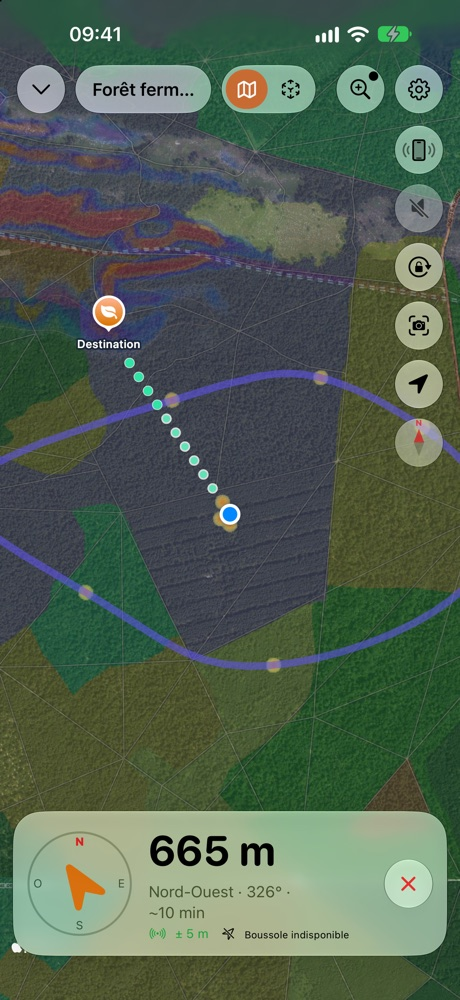

# SnapSpot

Vos coins. Vos cueillettes. À vous seuls.

**Prospectez les forêts, identifiez vos trouvailles, retrouvez vos meilleurs spots.** Le compagnon de terrain du
cueilleur de champignons, pour iPhone. Même sans réseau.

<ul class="badges">
<li>Fonctionne sans réseau</li>
<li>Sans compte</li>
<li>Sans publicité</li>
<li>Vos données restent sur l'iPhone</li>
</ul>

## Prospecter. Identifier. Mémoriser. Retrouver.

<figure><figcaption><b>1. Prospecter</b> Carte forestière, forêts publiques, forêts anciennes, géologie, pentes, relief, cadastre : les cartes IGN aident à repérer les milieux favorables, et se téléchargent avant de partir.</figcaption></figure>
<figure><figcaption><b>2. Identifier</b> Un modèle fait pour les champignons, sur l'iPhone, sans réseau. Plusieurs propositions, les ressemblances dangereuses signalées, jamais un verdict.</figcaption></figure>
<figure><figcaption><b>3. Mémoriser</b> Chaque photo géolocalisée devient un spot. Classez par espèce, retrouvez par saison, par année ou par comestibilité, et posez des repères : voiture, entrée de forêt, passage.</figcaption></figure>
<figure><figcaption><b>4. Retrouver</b> Carte, boussole ou réalité augmentée jusqu'au spot, avec des sons et des vibrations quand le téléphone reste dans la poche. Vos balades sont enregistrées.</figcaption></figure>

**SnapSpot n'est pas une carte de zones de cueillette.** Elle ne vous dit pas où aller : elle vous aide à
prospecter, puis garde la mémoire de vos propres coins. Les champignons reviennent d'une année à l'autre, au même
endroit et à la même période : les spots d'hier préparent la saison de demain.

## Identifier, avec un modèle fait pour les champignons

L'identification repose sur un **modèle spécialisé**, entraîné sur des milliers de photos de champignons de France et
embarqué dans l'app. Il est fondé sur BioCLIP, un modèle de reconnaissance du vivant de l'Imageomics Institute.

<video src="images/identification-direct.mp4" poster="images/identification-direct-poster.jpg" controls muted playsinline preload="none"></video>

*En direct : l'app analyse ce que vise la caméra, propose des espèces, signale les ressemblances dangereuses, puis
crée le spot.*

- **Plus de 200 espèces.** L'app ne les connaît pas toutes : certaines espèces mortelles en sont absentes faute de
  photos, et elle vous le rappelle.
- **Sur nos photos de test**, la bonne espèce arrive en tête dans environ 9 cas sur 10, et parmi les trois premières
  propositions dans près de 98 % des cas. L'app montre toujours plusieurs propositions et les critères à vérifier,
  jamais un verdict.
- **En direct** avec la caméra, ou sur vos photos déjà prises.
- **Tout sur l'iPhone** : aucune image ne part sur Internet, et cela marche en pleine forêt, sans réseau.
- **Apple Intelligence** (iPhone compatibles) apporte seulement une description de ce que montre la photo, comparée
  aux critères de la fiche. Il ne nomme jamais l'espèce : c'est le modèle SnapSpot qui propose.
- **Les espèces toxiques ou mortelles sont toujours signalées.** Vous pouvez aussi masquer les espèces non
  comestibles de la carte.

<figure><figcaption>En mode avion, tout fonctionne.</figcaption></figure>
<figure><figcaption>Une fiche par espèce, consultable hors réseau.</figcaption></figure>
<figure><figcaption>La saison de chaque espèce.</figcaption></figure>

> **Important** : l'identification est indicative et peut se tromper. Ne consommez jamais un champignon sur la foi de
> l'app : faites-le vérifier par un pharmacien ou une association mycologique.

## Prospecter et retrouver vos spots

Les cartes IGN se téléchargent à l'avance : photographies aériennes, plan, relief, carte forestière, forêts publiques,
forêts anciennes, cadastre, pentes, hydrographie, courbes de niveau, géologie. Un appui long sur la carte dit ce que
montre la couche à cet endroit.

<figure><figcaption>Téléchargez la zone avant de partir.</figcaption></figure>
<figure><figcaption>Vos photos, avec l'espèce et la comestibilité.</figcaption></figure>
<figure><figcaption>Filtrez par comestibilité.</figcaption></figure>

Le guidage vous mène à pied jusqu'à un spot : distance, direction, temps de marche, et en réalité augmentée un sonar
au sol qui montre la zone. Écran verrouillé, des bips et des vibrations vous disent si vous allez dans la bonne
direction, et une voix peut vous corriger le cap.

<video src="images/guidage-ra.mp4" poster="images/guidage-ra-poster.jpg" controls muted loop playsinline preload="none"></video>

*Le sonar : une onde part du spot et s'élargit au sol, à la taille réelle de la zone, pour juger de la distance.*

<figure><figcaption>Un appui long sur la carte, « Me guider » : un chemin de points vers le point choisi.</figcaption></figure>
<figure><figcaption>Distance, direction et mini-carte.</figcaption></figure>
<figure><figcaption>Votre balade sur l'écran verrouillé.</figcaption></figure>
<figure><figcaption>Un parcours, avec ses photos.</figcaption></figure>

*Captures réalisées avec des données de démonstration.*

## Confidentialité absolue

- **Aucun serveur SnapSpot, aucun compte, aucune publicité, aucun suivi, aucune statistique d'usage.**
- Vos photos, vos spots, vos parcours et vos analyses **restent sur votre iPhone**. Nous ne pouvons pas les voir,
  même si nous le voulions.
- L'identification, la description et le guidage se font **sur l'appareil**.
- Seuls les services publics de cartes et de météo sont contactés (cartes IGN, noms de lieux, recherche d'un lieu,
  pluie des 7 derniers jours), comme n'importe quelle page web, sans jamais envoyer vos photos ni vos spots. Les
  cartes téléchargées à l'avance fonctionnent sans réseau.
- Vos coins à champignons sont à vous : ils ne quittent l'iPhone que si vous les partagez vous-même.

## Aussi dans l'app

- **Indices de terrain** : notez l'odeur, la chair, le milieu ou la sporée, par dictée ou par suggestions. Ils
  pondèrent les propositions et un avis comparatif d'Apple Intelligence, que vous pouvez relancer.
- **Rechercher sur la carte** : un lieu, une adresse, des coordonnées, ou une de vos cueillettes, un parcours, un repère.
- **Pluie et lune** : la pluie des 7 derniers jours et l'humidité du sol sur la fiche « Ici », et la phase de la lune
  du jour, à titre indicatif.
- **Partage depuis Photos** : la feuille de partage de l'iPhone envoie des photos à SnapSpot, qui lit leur position.
- **Export et transfert** : GPX, spots, parcours avec leurs photos, ou toute votre collection vers un autre iPhone par
  AirDrop.
- **App Santé** : vos balades peuvent y être enregistrées comme randonnées (écriture seulement).
- **Fiches d'espèces** : plus de 200, avec saisons, milieux, photos libres de droits et crédits.
- **Neuf langues** : français, anglais, allemand, espagnol, italien, portugais, néerlandais, polonais et suédois.

[Politique de confidentialité](confidentialite) · [Assistance](assistance) · Contact : snapspot.app@outlook.com
