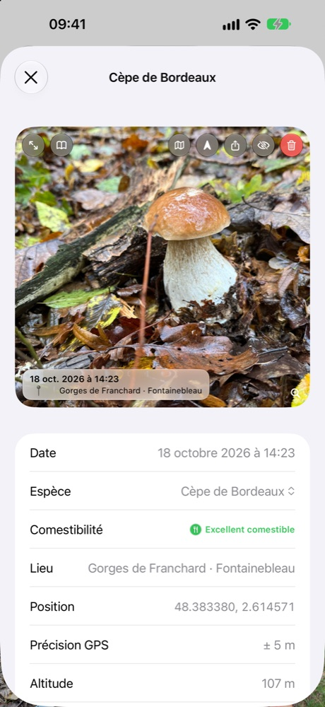
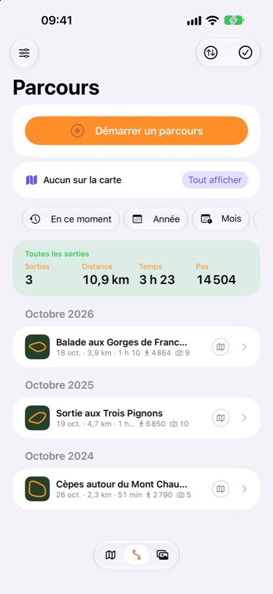

# SnapSpot

**Retrouvez vos coins à champignons, identifiez ce que vous cueillez, et gardez tout pour vous.**
L'app des cueilleurs, pensée pour la forêt, même sans réseau. Pour iPhone.

## À quoi sert SnapSpot ?

**SnapSpot n'est pas une carte de zones de cueillette.** Elle ne vous dit pas où aller : elle vous aide à
**prospecter** et à **garder la mémoire de vos propres coins**.

- **Prospecter** : la carte forestière, les forêts publiques, les forêts anciennes, la géologie, les pentes, le relief
  ou le cadastre (cartes IGN, utilisables hors ligne) aident à repérer les milieux favorables à chaque espèce.
- **Cartographier vos spots** : chaque photo géolocalisée devient un spot que vous retrouvez facilement, par carte,
  boussole ou réalité augmentée.
- **Les classer** par espèce, puis les rechercher par saison, par année ou par comestibilité.

Les champignons reviennent d'une année à l'autre, au même endroit et à la même période : vos spots d'hier préparent
votre saison de demain.

1. **Vous photographiez** vos trouvailles avec l'appareil photo de l'iPhone ou celui de l'app. La position est
   enregistrée avec la photo.
2. **L'app propose une espèce** et vous montre sa fiche : comestibilité, ressemblances, milieu, saison.
3. **Vos cueillettes se placent sur une carte** : en zones de chaleur, hexagones ou regroupements, filtrables par
   espèce, par année et par saison. D'une année à l'autre, vos meilleurs coins se dessinent.
4. **Vous y retournez** : l'app vous guide à pied jusqu'au spot, par carte, boussole ou réalité augmentée, et par
   des sons et des vibrations quand le téléphone reste dans la poche.
5. **Vous enregistrez vos balades** : tracé, distance, dénivelé, temps de marche et à l'arrêt, avec une Live Activity
   sur l'écran verrouillé.

<video src="images/guidage-ra.mp4" poster="images/guidage-ra-poster.jpg" controls muted loop playsinline preload="none" style="max-width:260px;width:100%;border-radius:14px;border:1px solid #ddd"></video>

*Le sonar : une onde part du spot et s'élargit au sol, à la taille réelle de la zone, pour juger de la distance.*

## Un modèle d'identification entraîné pour les champignons

L'identification repose sur un **modèle spécialisé**, entraîné sur des milliers de photos de champignons de France et
embarqué dans l'app. Il est fondé sur BioCLIP, un modèle de reconnaissance du vivant de l'Imageomics Institute.

<video src="images/identification-direct.mp4" poster="images/identification-direct-poster.jpg" controls muted playsinline preload="none" style="max-width:260px;width:100%;border-radius:14px;border:1px solid #ddd"></video>

*L'identification en direct : l'app analyse ce que vise la caméra, propose des espèces, signale les sosies dangereux, puis crée le spot.*

- **Plus de 200 espèces** reconnues. L'app ne les connaît pas toutes : certaines espèces mortelles en sont absentes faute de
  photos, et elle vous le rappelle.
- **Sur nos photos de test, la bonne espèce arrive en tête dans environ 9 cas sur 10, et parmi les trois premières
  propositions dans près de 98 % des cas.** L'app vous montre toujours plusieurs propositions et les critères à
  vérifier, jamais un verdict.
- **En direct** avec la caméra, ou sur vos photos déjà prises.
- **Tout se passe sur l'iPhone** : aucune image ne part sur Internet, et cela marche en pleine forêt, sans réseau.
- **Apple Intelligence** (iPhone compatibles) apporte seulement une description de ce que montre la photo, comparée aux
  critères de la fiche. Il ne nomme jamais l'espèce : c'est le modèle SnapSpot qui propose.
- Une espèce toxique ou mortelle est toujours signalée, et vous pouvez masquer les espèces non comestibles de la
  carte.

> **Important** : l'identification est indicative et peut se tromper. Ne consommez jamais un champignon sur la foi de
> l'app : faites-le vérifier par un pharmacien ou une association mycologique.

## En images

<figure><figcaption>Vos cueillettes en zones de chaleur, sur la carte forestière IGN, avec vos parcours.</figcaption></figure>
<figure><figcaption>En direct : des espèces avec un pourcentage, et l'alerte si l'une est dangereuse.</figcaption></figure>
<figure><figcaption>Guidage en réalité augmentée, ici en mode avion : sonar au sol, spot à 6 m, groupe de 3 spots à 95 m.</figcaption></figure>
<figure><figcaption>Le guidage : distance, direction, temps à pied, précision GPS et mini-carte avec votre tracé.</figcaption></figure>
<figure><figcaption>Identification en mode avion : tout se passe sur l'iPhone, sans réseau.</figcaption></figure>
<figure><figcaption>Une fiche par espèce, consultable hors réseau : comestibilité, milieu, saison, photos libres avec crédits.</figcaption></figure>
<figure><figcaption>Toutes vos photos, avec l'espèce et la comestibilité.</figcaption></figure>
<figure><figcaption>Le détail : lieu, position, altitude, distance.</figcaption></figure>
<figure><figcaption>Masquez les espèces non comestibles, ou ne gardez que les mortelles.</figcaption></figure>
<figure><figcaption>Sur l'écran verrouillé : durée, distance, vitesse, dénivelé et boutons pause, repère, photo, retour et arrêt.</figcaption></figure>
<figure><figcaption>Cartes hors ligne : choisissez vos couches forestières IGN et téléchargez la zone autour de vos spots.</figcaption></figure>
<figure><figcaption>Une balade : tracé coloré, vitesse, altitude et photos prises en chemin.</figcaption></figure>
<figure><figcaption>Vos sorties et leurs statistiques.</figcaption></figure>

Photos d'écran réalisées avec des données de démonstration.

## Confidentialité absolue

- **Aucun serveur SnapSpot, aucun compte, aucune publicité, aucun suivi, aucune statistique d'usage.**
- Vos photos, vos spots, vos parcours et vos analyses **restent sur votre iPhone**. Nous ne pouvons pas les voir,
  même si nous le voulions.
- L'identification, la description et le guidage se font **sur l'appareil**.
- Seul le téléchargement des cartes IGN contacte un service public, comme n'importe quelle page web.
  Téléchargées à l'avance, elles fonctionnent ensuite sans réseau.
- Vos coins à champignons sont à vous : ils ne quittent l'iPhone que si vous les partagez vous-même.

## Aussi dans l'app

- **Cartes IGN hors ligne** : photographies aériennes, plan, relief, forêts publiques, forêts anciennes, cadastre,
  pentes, géologie. Un appui long sur la carte dit ce que montre la couche à cet endroit.
- **Plus de 200 fiches d'espèces**, avec saisons, milieux, photos libres de droits et crédits.
- **Partage depuis Photos** : la feuille de partage de l'iPhone envoie des photos à SnapSpot, qui lit leur position.
- **Export et transfert** : GPX, spots, parcours avec leurs photos, ou toute votre collection vers un autre iPhone par
  AirDrop.
- **App Santé** : vos balades peuvent y être enregistrées comme randonnées (écriture seulement).
- Disponible en français, anglais, allemand, espagnol, italien, portugais, néerlandais, polonais et suédois.

[Politique de confidentialité](confidentialite) · [Assistance](assistance) · Contact : snapspot.app@outlook.com
