# SnapSpot

**Retrouvez vos coins à champignons, identifiez ce que vous cueillez, et gardez tout pour vous.**
L'app des cueilleurs, pensée pour la forêt, même sans réseau. Pour iPhone.

<figure>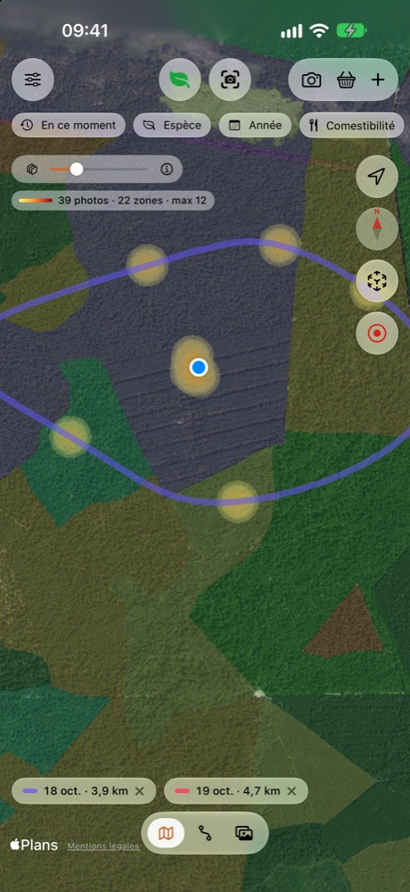<figcaption>Vos cueillettes sur la carte forestière IGN.</figcaption></figure>
<figure>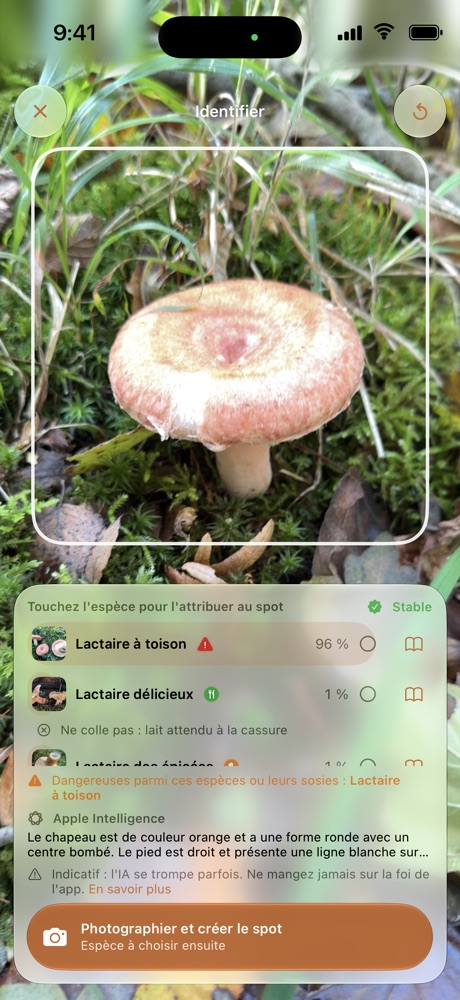<figcaption>Identification en direct.</figcaption></figure>
<figure>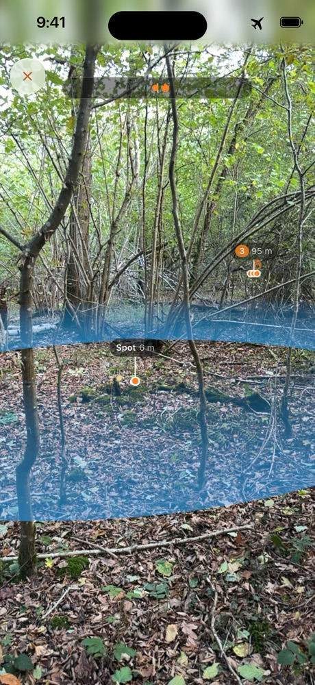<figcaption>Guidage en réalité augmentée.</figcaption></figure>

## À quoi sert SnapSpot ?

**SnapSpot n'est pas une carte de zones de cueillette.** Elle ne vous dit pas où aller : elle vous aide à
**prospecter** et à **garder la mémoire de vos propres coins**.

- **Prospecter.** La carte forestière, les forêts publiques, les forêts anciennes, la géologie, les pentes, le relief
  ou le cadastre (cartes IGN, utilisables hors ligne) aident à repérer les milieux favorables à chaque espèce.
- **Cartographier vos spots.** Chaque photo géolocalisée devient un spot que vous retrouvez facilement, par carte,
  boussole ou réalité augmentée.
- **Les classer.** Par espèce, puis les rechercher par saison, par année ou par comestibilité.

Les champignons reviennent d'une année à l'autre, au même endroit et à la même période : les spots d'hier préparent
la saison de demain.

## Comment ça marche

1. **Vous photographiez** une trouvaille avec l'appareil photo de l'iPhone ou celui de l'app. La position est
   enregistrée avec la photo.
2. **L'app propose une espèce** et vous montre sa fiche : comestibilité, ressemblances, milieu, saison.
3. **Vos cueillettes se placent sur une carte**, en zones de chaleur, hexagones ou regroupements, que vous filtrez par
   espèce, par année ou par saison.
4. **Vous y retournez** : l'app vous guide à pied jusqu'au spot, par carte, boussole ou réalité augmentée, avec des
   sons et des vibrations quand le téléphone reste dans la poche.
5. **Vous enregistrez vos balades** : tracé, distance, dénivelé, temps de marche et à l'arrêt.

## Identifier, avec un modèle fait pour les champignons

L'identification repose sur un **modèle spécialisé**, entraîné sur des milliers de photos de champignons de France et
embarqué dans l'app. Il est fondé sur BioCLIP, un modèle de reconnaissance du vivant de l'Imageomics Institute.

<video src="images/identification-direct.mp4" poster="images/identification-direct-poster.jpg" controls muted playsinline preload="none"></video>

*En direct : l'app analyse ce que vise la caméra, propose des espèces, signale les ressemblances dangereuses, puis
crée le spot.*

- **Plus de 200 espèces.** L'app ne les connaît pas toutes : certaines espèces mortelles en sont absentes faute de
  photos, et elle vous le rappelle.
- **Sur nos photos de test**, la bonne espèce arrive en tête dans environ 9 cas sur 10, et parmi les trois premières
  propositions dans près de 98 % des cas. L'app montre toujours plusieurs propositions et les critères à vérifier,
  jamais un verdict.
- **En direct** avec la caméra, ou sur vos photos déjà prises.
- **Tout sur l'iPhone** : aucune image ne part sur Internet, et cela marche en pleine forêt, sans réseau.
- **Apple Intelligence** (iPhone compatibles) apporte seulement une description de ce que montre la photo, comparée
  aux critères de la fiche. Il ne nomme jamais l'espèce : c'est le modèle SnapSpot qui propose.
- **Les espèces toxiques ou mortelles sont toujours signalées.** Vous pouvez aussi masquer les espèces non
  comestibles de la carte.

<figure>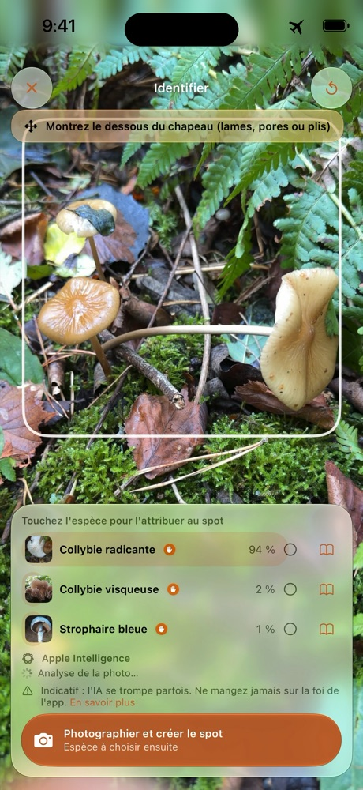<figcaption>En mode avion, tout fonctionne.</figcaption></figure>
<figure>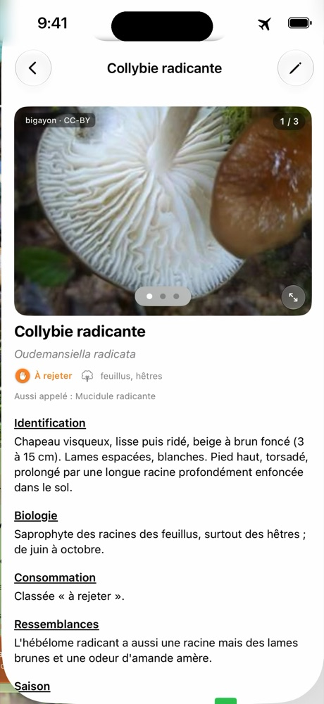<figcaption>Une fiche par espèce, consultable hors réseau.</figcaption></figure>
<figure>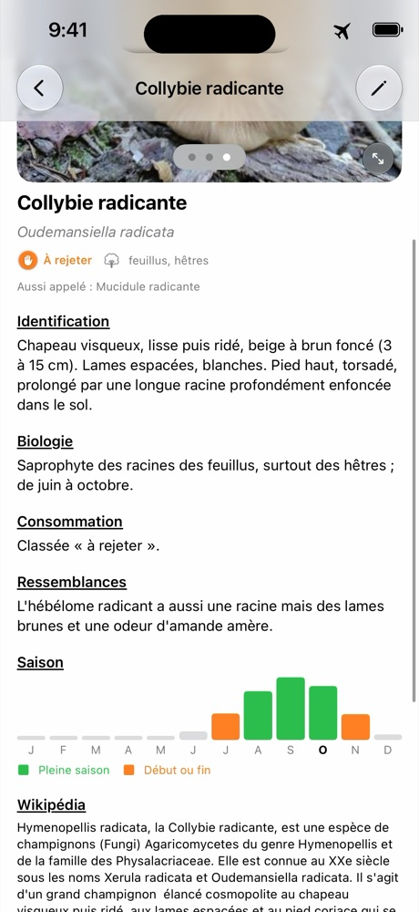<figcaption>La saison de chaque espèce.</figcaption></figure>

> **Important** : l'identification est indicative et peut se tromper. Ne consommez jamais un champignon sur la foi de
> l'app : faites-le vérifier par un pharmacien ou une association mycologique.

## Prospecter et retrouver vos spots

Les cartes IGN se téléchargent à l'avance : photographies aériennes, plan, relief, carte forestière, forêts publiques,
forêts anciennes, cadastre, pentes, hydrographie, courbes de niveau, géologie. Un appui long sur la carte dit ce que
montre la couche à cet endroit.

<figure>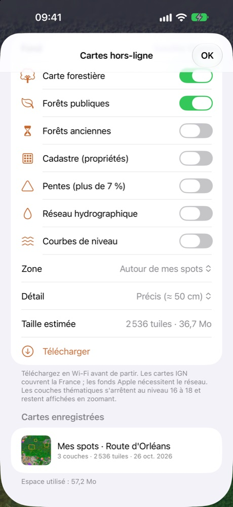<figcaption>Téléchargez la zone avant de partir.</figcaption></figure>
<figure>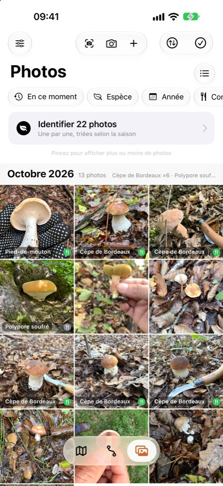<figcaption>Vos photos, avec l'espèce et la comestibilité.</figcaption></figure>
<figure>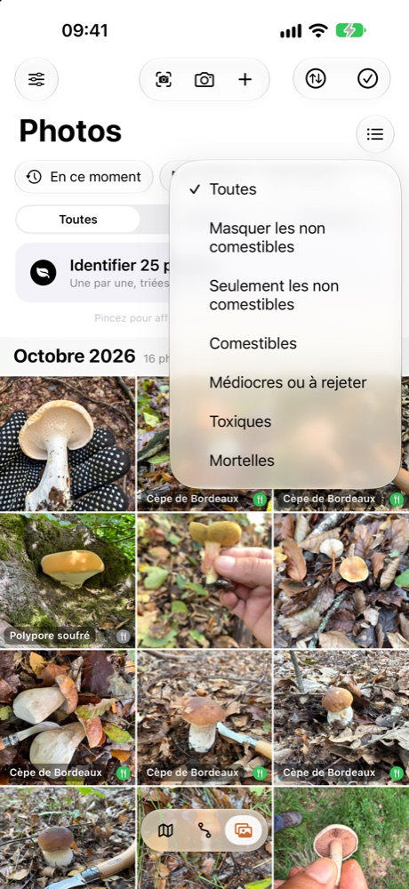<figcaption>Filtrez par comestibilité.</figcaption></figure>

Le guidage vous mène à pied jusqu'à un spot : distance, direction, temps de marche, et en réalité augmentée un sonar
au sol qui montre la zone. Écran verrouillé, des bips et des vibrations vous disent si vous allez dans la bonne
direction, et une voix peut vous corriger le cap.

<video src="images/guidage-ra.mp4" poster="images/guidage-ra-poster.jpg" controls muted loop playsinline preload="none"></video>

*Le sonar : une onde part du spot et s'élargit au sol, à la taille réelle de la zone, pour juger de la distance.*

<figure>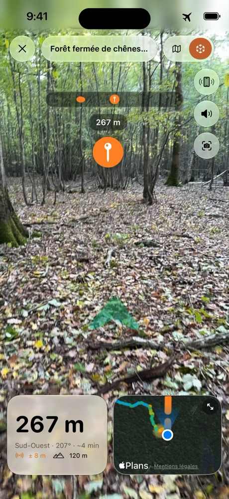<figcaption>Distance, direction et mini-carte.</figcaption></figure>
<figure>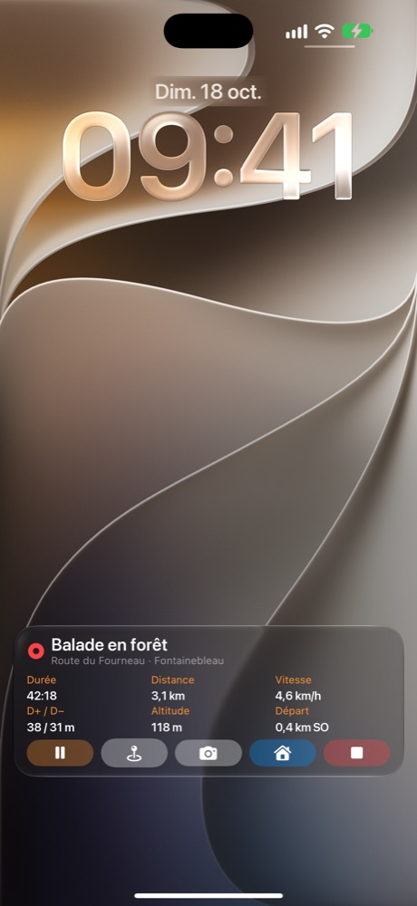<figcaption>Votre balade sur l'écran verrouillé.</figcaption></figure>
<figure>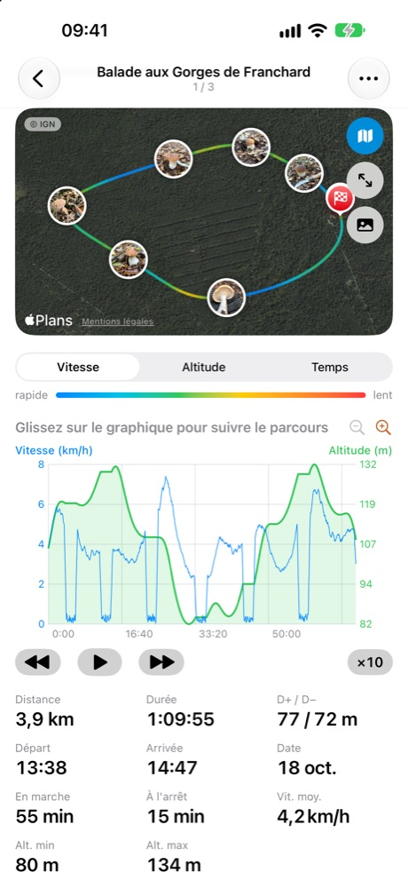<figcaption>Un parcours, avec ses photos.</figcaption></figure>

*Captures réalisées avec des données de démonstration.*

## Confidentialité absolue

- **Aucun serveur SnapSpot, aucun compte, aucune publicité, aucun suivi, aucune statistique d'usage.**
- Vos photos, vos spots, vos parcours et vos analyses **restent sur votre iPhone**. Nous ne pouvons pas les voir,
  même si nous le voulions.
- L'identification, la description et le guidage se font **sur l'appareil**.
- Seul le téléchargement des cartes IGN contacte un service public, comme n'importe quelle page web. Une fois
  téléchargées, elles fonctionnent sans réseau.
- Vos coins à champignons sont à vous : ils ne quittent l'iPhone que si vous les partagez vous-même.

## Aussi dans l'app

- **Partage depuis Photos** : la feuille de partage de l'iPhone envoie des photos à SnapSpot, qui lit leur position.
- **Export et transfert** : GPX, spots, parcours avec leurs photos, ou toute votre collection vers un autre iPhone par
  AirDrop.
- **App Santé** : vos balades peuvent y être enregistrées comme randonnées (écriture seulement).
- **Fiches d'espèces** : plus de 200, avec saisons, milieux, photos libres de droits et crédits.
- **Neuf langues** : français, anglais, allemand, espagnol, italien, portugais, néerlandais, polonais et suédois.

[Politique de confidentialité](confidentialite) · [Assistance](assistance) · Contact : snapspot.app@outlook.com
