

# SnapSpot: Paddenstoelen

Jouw plekjes. Jouw vondsten. Alleen van jou.

**Verken de bossen, determineer je vondsten, vind je beste spots terug.** De veldgids voor paddenstoelenzoekers,
voor iPhone. Ook zonder netwerk.

<ul class="badges">
<li>Werkt zonder netwerk</li>
<li>Geen account</li>
<li>Geen reclame</li>
<li>Je gegevens blijven op je iPhone</li>
</ul>

## Verkennen. Determineren. Onthouden. Terugvinden.

<figure>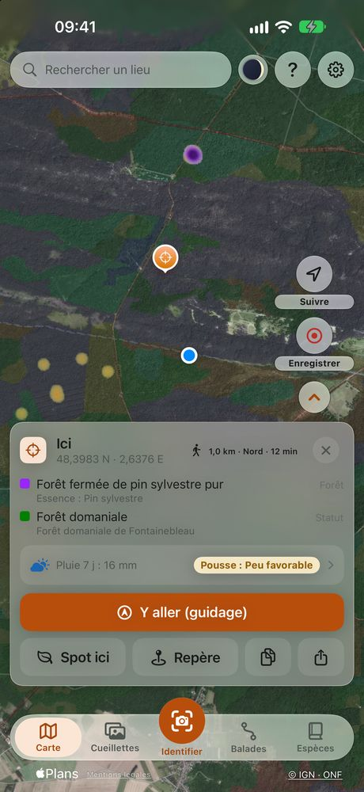<figcaption><b>1. Verkennen</b> Boskaart, openbare bossen, oude bossen, geologie, hellingen, reliëf, kadaster: de IGN-kaarten helpen gunstige biotopen te vinden en zijn te downloaden voordat je vertrekt.</figcaption></figure>
<figure>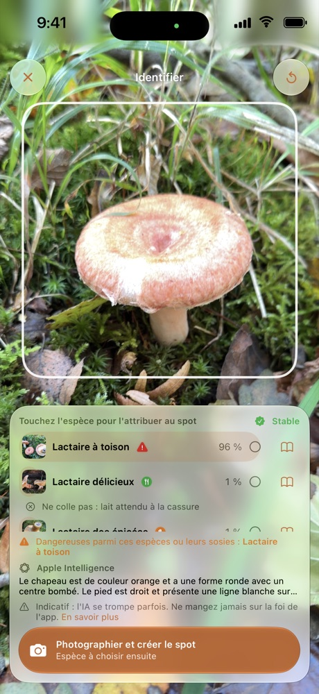<figcaption><b>2. Determineren</b> Een model gemaakt voor paddenstoelen, op de iPhone, zonder netwerk. Meerdere voorstellen, gevaarlijke verwisselingen aangegeven, nooit een oordeel.</figcaption></figure>
<figure>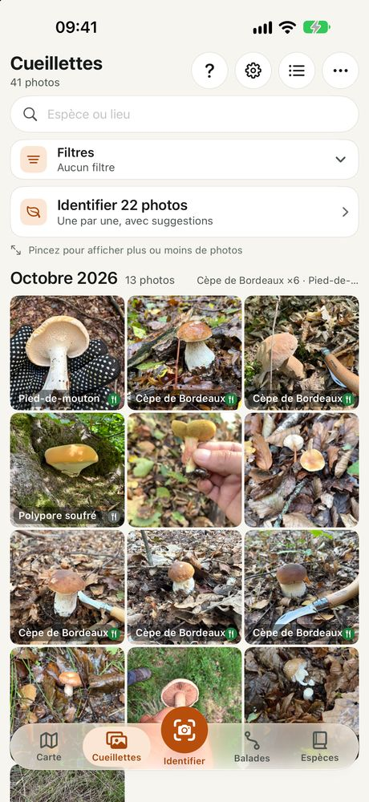<figcaption><b>3. Onthouden</b> Elke foto met locatie wordt een spot. Sorteer per soort, vind terug per seizoen, jaar of eetbaarheid en zet markeringen: auto, bosingang, doorgang.</figcaption></figure>
<figure>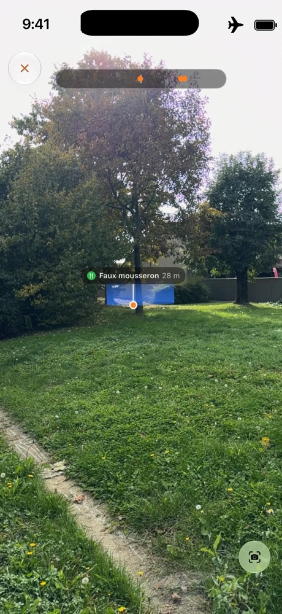<figcaption><b>4. Terugvinden</b> Kaart, kompas of augmented reality tot aan de spot, met geluiden en trillingen als de telefoon in je zak blijft. Je wandelingen worden opgenomen.</figcaption></figure>

**SnapSpot is geen kaart van plukgebieden.** De app zegt je niet waar je heen moet: ze helpt je te verkennen en
bewaart daarna het geheugen van je eigen plekjes. Paddenstoelen komen jaar na jaar terug, op dezelfde plek en in
dezelfde periode: de spots van gisteren bereiden het seizoen van morgen voor.

## Determineren, met een model gemaakt voor paddenstoelen

De determinatie berust op een **gespecialiseerd model**, getraind op duizenden foto's van Franse paddenstoelen en
ingebouwd in de app. Het is gebaseerd op BioCLIP, een model voor het herkennen van levende wezens van het Imageomics
Institute.

<video src="../images/identification-direct.mp4" poster="../images/identification-direct-poster.jpg" controls muted playsinline preload="none"></video>

*Live: de app analyseert waar de camera op gericht is, stelt soorten voor, geeft gevaarlijke verwisselingen aan en
maakt dan de spot aan.*

- **Meer dan 200 soorten.** De app kent ze niet allemaal: sommige dodelijke soorten ontbreken bij gebrek aan foto's,
  en de app herinnert je daaraan.
- **Op onze testfoto's** staat de juiste soort in ongeveer 9 van de 10 gevallen bovenaan, en in bijna 98 % van de
  gevallen bij de eerste drie voorstellen. De app toont altijd meerdere voorstellen en de te controleren kenmerken,
  nooit een oordeel.
- **Live** met de camera, of op foto's die je al genomen hebt.
- **Alles op de iPhone**: er gaat geen enkele afbeelding het internet op, en het werkt midden in het bos, zonder
  netwerk.
- **Apple Intelligence** (compatibele iPhones) levert alleen een beschrijving van wat de foto toont, vergeleken met
  de kenmerken van de soortkaart. Het noemt nooit de soort: de voorstellen komen van het SnapSpot-model.
- **Giftige of dodelijke soorten worden altijd aangegeven.** Je kunt niet-eetbare soorten ook van de kaart
  verbergen.

<figure>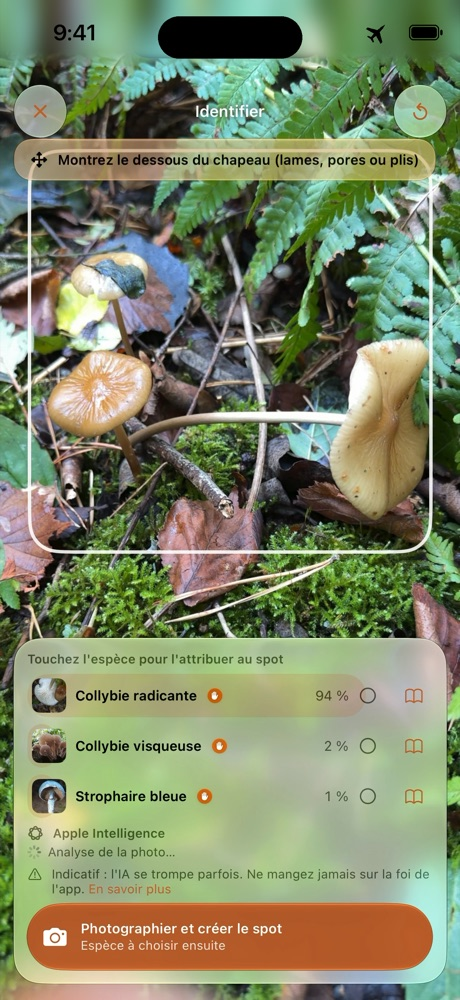<figcaption>In vliegtuigmodus werkt alles.</figcaption></figure>
<figure>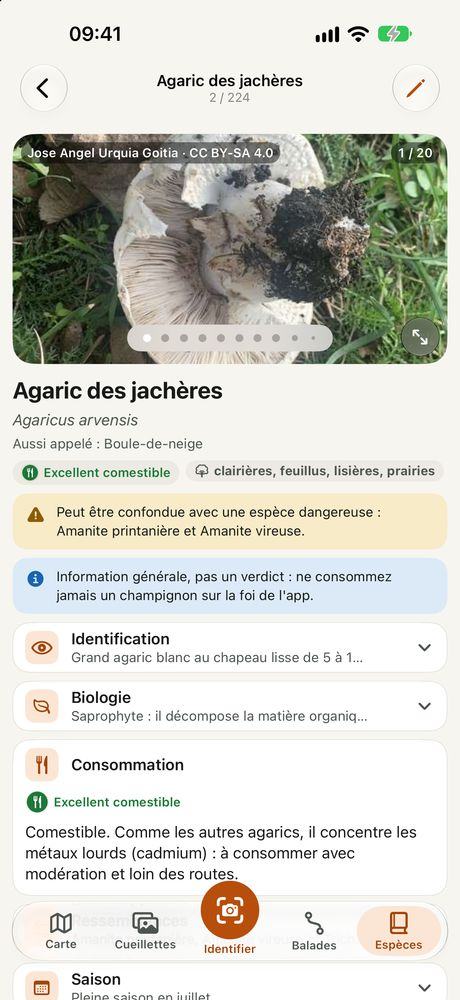<figcaption>Een kaart per soort, offline te raadplegen.</figcaption></figure>
<figure>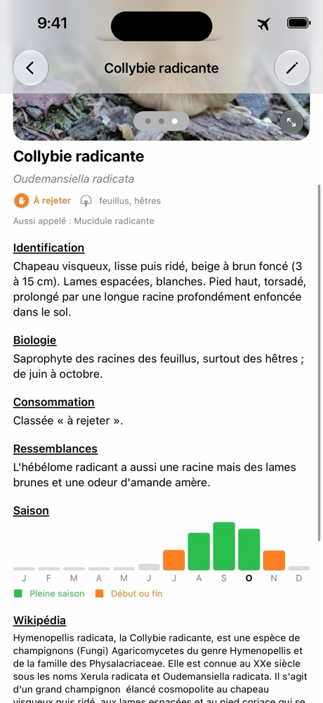<figcaption>Het seizoen van elke soort.</figcaption></figure>

<figure>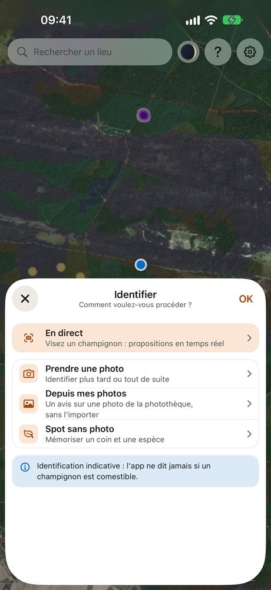<figcaption>Determineer: live, vanaf een foto of vanaf je foto's.</figcaption></figure>
<figure>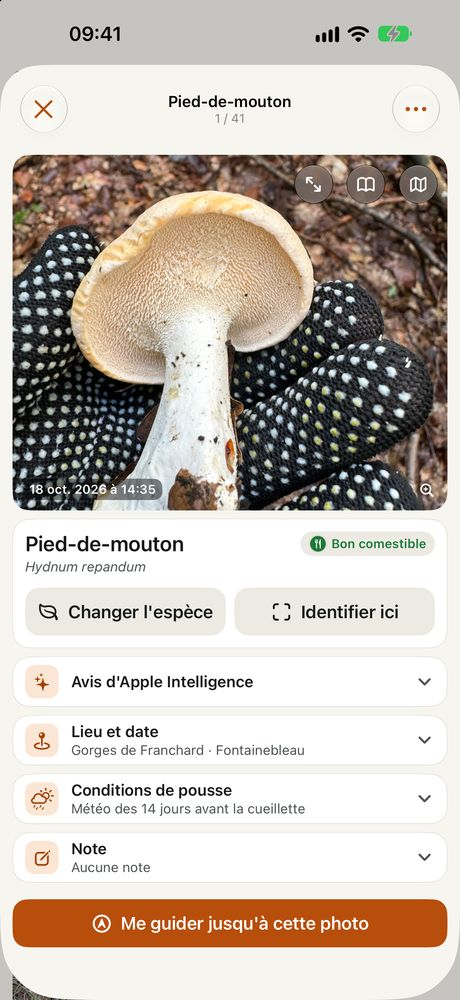<figcaption>Elke foto: soort, oordeel van Apple Intelligence, plaats en datum.</figcaption></figure>
<figure>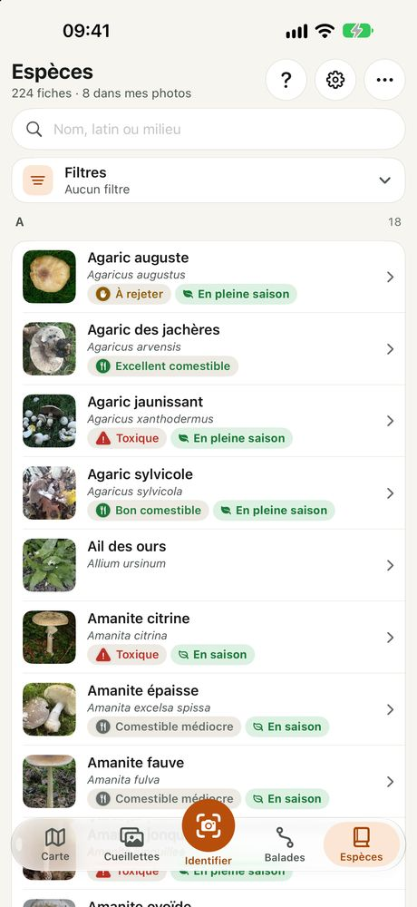<figcaption>De soortencatalogus: zoeken, seizoen, eetbaarheid.</figcaption></figure>

> **Belangrijk**: de determinatie is indicatief en kan fout zijn. Eet nooit een paddenstoel op basis van de app: laat
> hem controleren door een apotheker of een mycologische vereniging.

## Verkennen en je spots terugvinden

De IGN-kaarten worden vooraf gedownload: luchtfoto's, plattegrond, reliëf, boskaart, openbare bossen, oude bossen,
kadaster, hellingen, waterlopen, hoogtelijnen, geologie. Een lange druk op de kaart zegt wat de laag op die plek
toont.

- **Bodemkaart (INRAE)** naast de boslagen: het bodemtype is met de legenda af te lezen met een lange druk.
- **Elke laag heeft zijn eigen transparantie**, en met een algemene schuif kijk je door de lagen heen naar de satellietfoto.

<figure>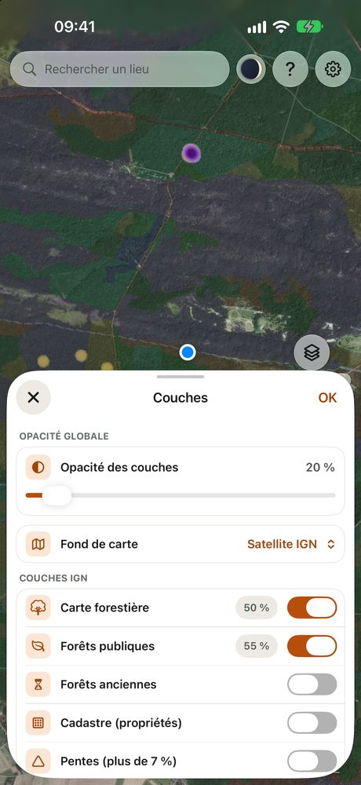<figcaption>De lagen en hun transparantie, op de kaart.</figcaption></figure>
<figure><figcaption>Een lange druk: wat de lagen hier tonen, en de groeiomstandigheden.</figcaption></figure>
<figure>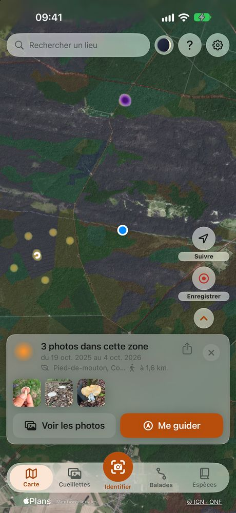<figcaption>Een zone: de foto's die op dezelfde plek zijn genomen.</figcaption></figure>

<figure>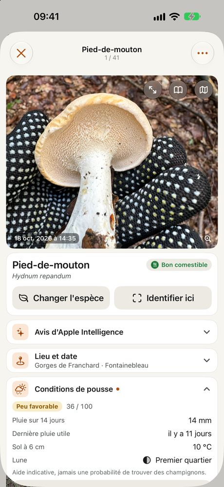<figcaption>De groeiomstandigheden vóór de vondst: regen, bodem, maan.</figcaption></figure>
<figure>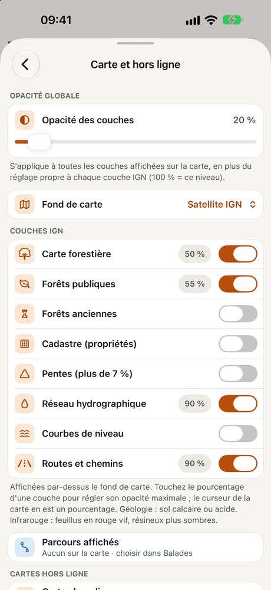<figcaption>Lagen en offline kaarten, in de instellingen.</figcaption></figure>
<figure>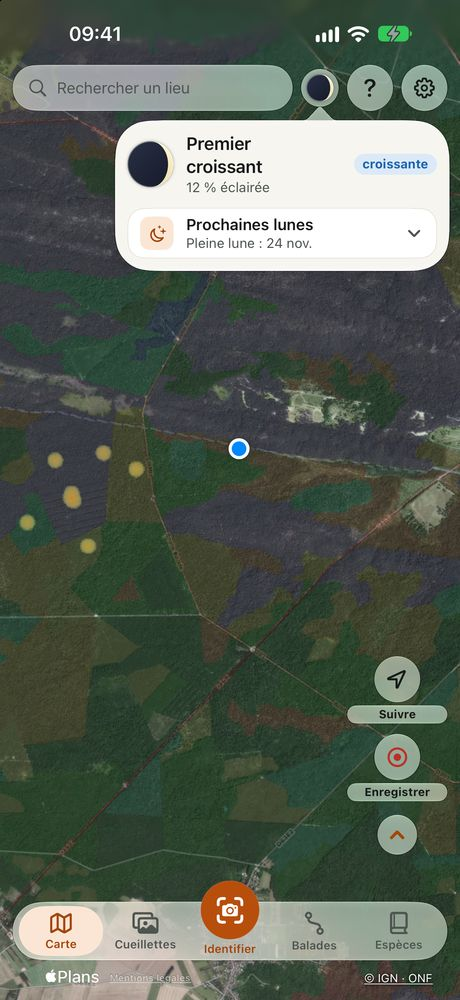<figcaption>De maanfase, uitsluitend ter informatie.</figcaption></figure>

## Je vondsten onthouden

Elke foto met locatie wordt een spot. Blader erdoorheen als raster of lijst, filter op periode, soort, jaar of eetbaarheid, groepeer de foto's van dezelfde paddenstoel, zet markeringen (auto, waterpunt, hut, opvallende boom, uitkijkpunt) en voeg foto's toe uit je bibliotheek, een album of een andere iPhone. Elke foto bewaart zijn plaats, zijn datum, het weer van de voorgaande dagen en een indicatieve index van de groeiomstandigheden.

<figure>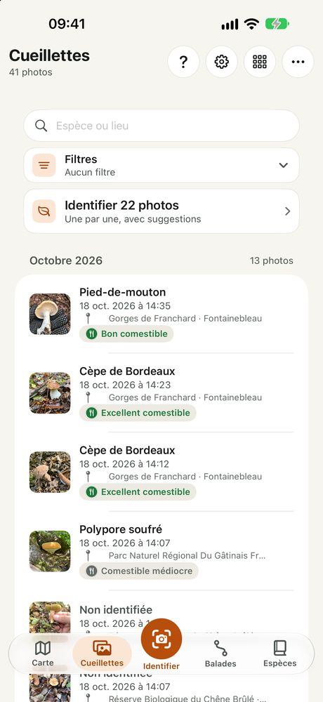<figcaption>De lijst, met soort en eetbaarheid.</figcaption></figure>
<figure>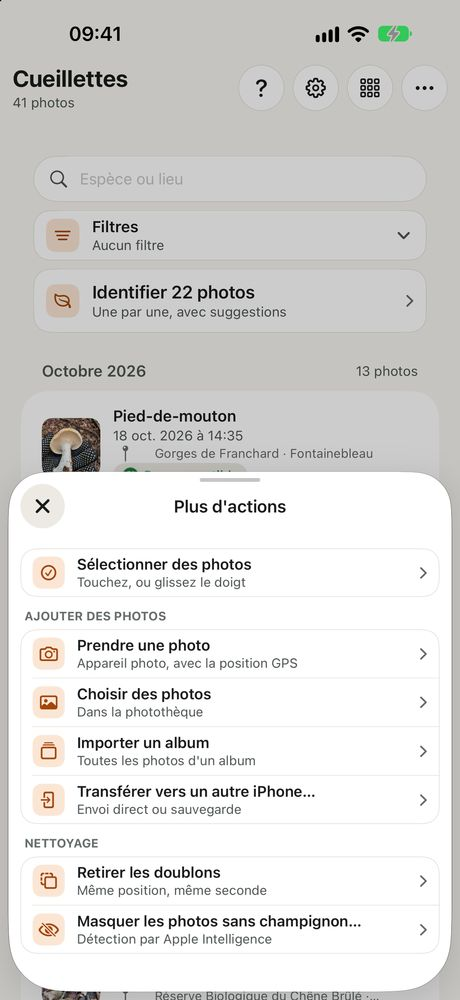<figcaption>Foto's toevoegen, importeren, opruimen.</figcaption></figure>
<figure>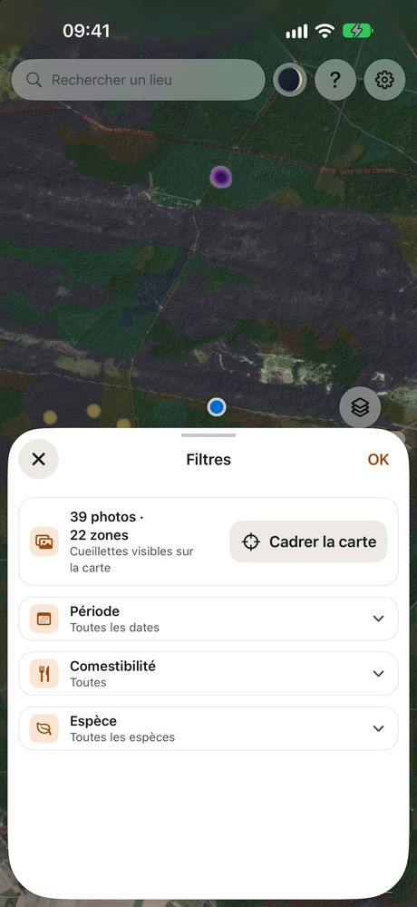<figcaption>Filteren op periode, soort, eetbaarheid.</figcaption></figure>

## Een spot terugvinden

De navigatie brengt je te voet naar een spot: afstand, richting, looptijd en in augmented reality een sonar op de
grond die het gebied toont. Bij vergrendeld scherm vertellen piepjes en trillingen of je de goede kant op gaat, en een
stem kan je koers corrigeren.

<video src="../images/guidage-ra.mp4" poster="../images/guidage-ra-poster.jpg" controls muted loop playsinline preload="none"></video>

*De sonar: een golf vertrekt vanaf de spot en verbreedt zich over de grond, op de werkelijke grootte van het gebied,
om de afstand in te schatten.*

- **Drie weergaven**: kaart, radarkompas of augmented reality, met een lade die je omhoog trekt voor details of minimaliseert om de kaart in het oog te houden.
- **Meerdere punten achter elkaar**: koppel spots tot een route, of zet punten op de kaart en laat SnapSpot je van het ene naar het volgende leiden.

<figure>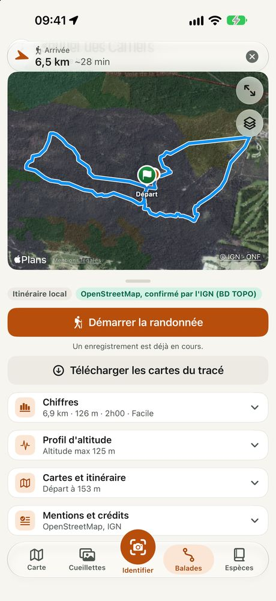<figcaption>De navigatie, geminimaliseerd op de kaart.</figcaption></figure>
<figure>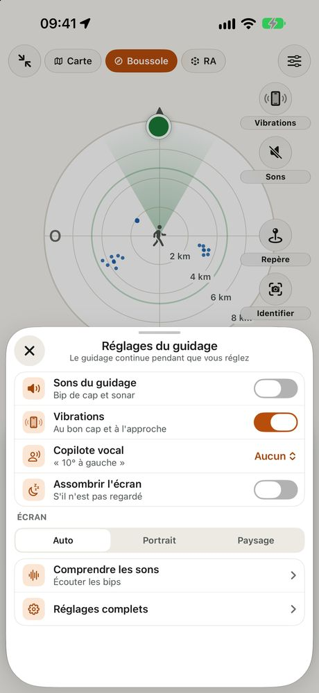<figcaption>Navigatie-instellingen: geluiden, trillingen, stem.</figcaption></figure>
<figure>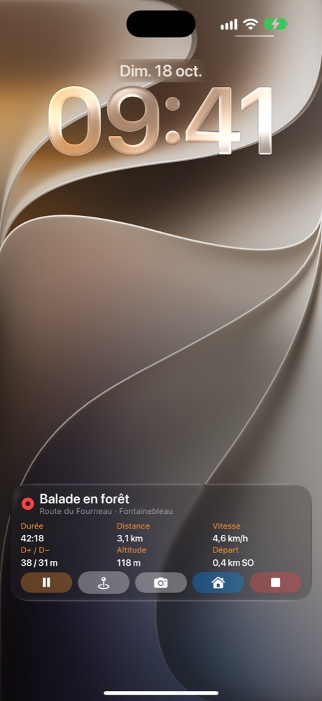<figcaption>Je wandeling op het vergrendelscherm.</figcaption></figure>

*Schermafbeeldingen gemaakt met demonstratiegegevens.*

## Wandelen en je eigen routes maken

- **GPS-registratie** van je wandelingen: afstand, hoogteverschil, snelheid, pauzes en markeringen, ook met vergrendeld scherm.
- **Je eigen routes**: koppel je vondsten of zet punten op de kaart, en SnapSpot leidt je van punt naar punt.
- **Terug naar de start** in rechte lijn, langs je eigen spoor of over paden. Alleen „Via de paden” raadpleegt de routedienst van het IGN, met je positie en de bestemming, nooit je foto's of spots.
- **Opnamelade**: duur, afstand, snelheid en markeringen in één oogopslag, pauze, stop en «Terug naar de start» onder je duim.
- **Autodetectie**: vergeet je de opname in de auto te stoppen, dan stelt SnapSpot voor het einde van de tocht af te knippen.
- **Zonsondergangsherinnering**: een melding wanneer het tijd is om terug te keren, zodat de nacht je niet verrast.

<figure>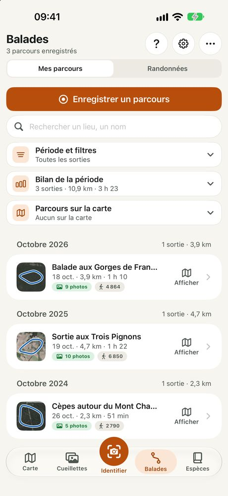<figcaption>Je tochten, per periode.</figcaption></figure>
<figure>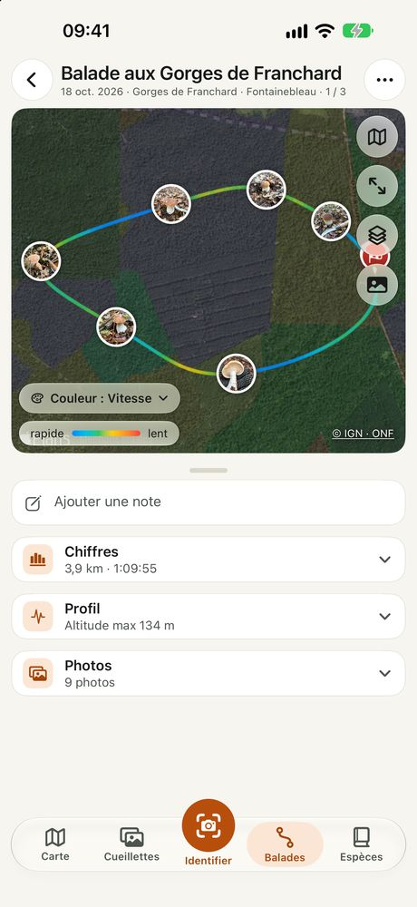<figcaption>Een tocht met zijn foto's en zijn grafiek.</figcaption></figure>
<figure>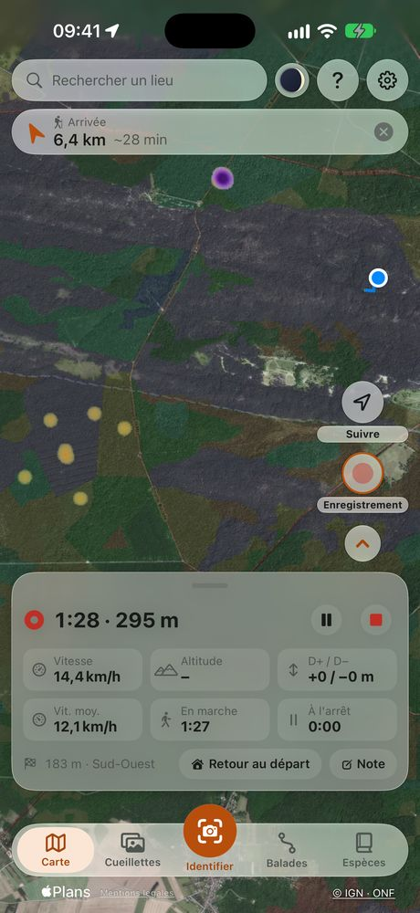<figcaption>De opname: duur, afstand, terug naar de start.</figcaption></figure>

<figure>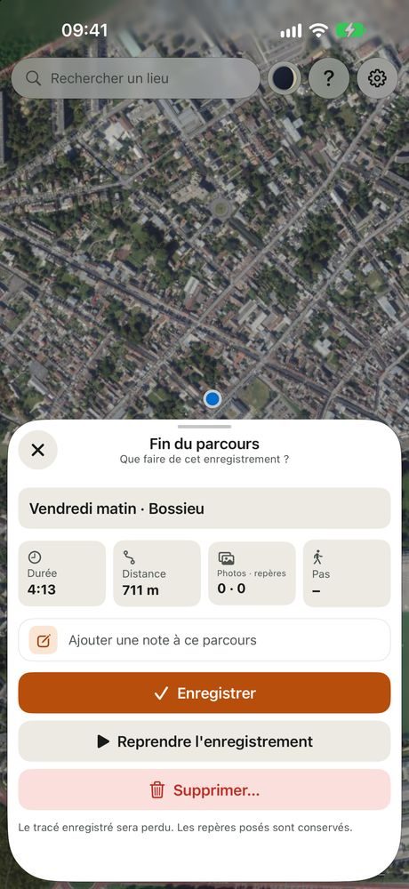<figcaption>Einde van een tocht: bewaren, hervatten of verwijderen.</figcaption></figure>
<figure>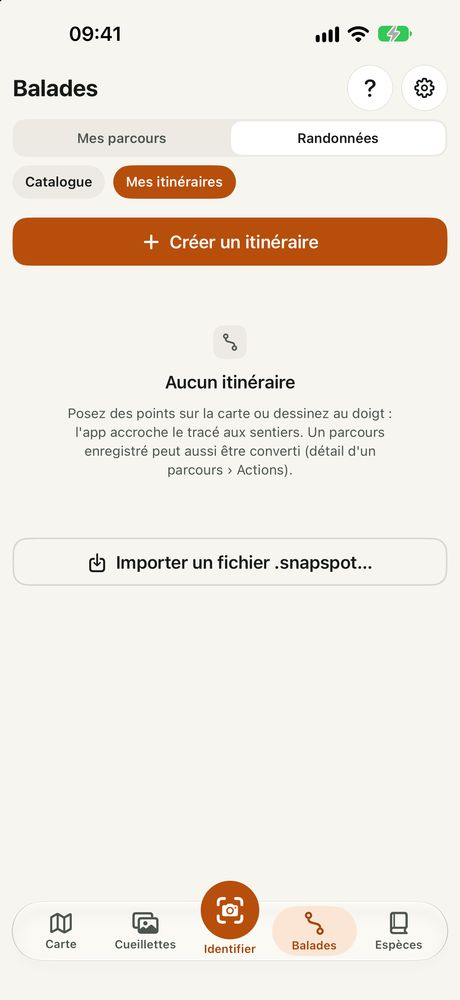<figcaption>Mijn routes: tekenen, dan delen.</figcaption></figure>
<figure>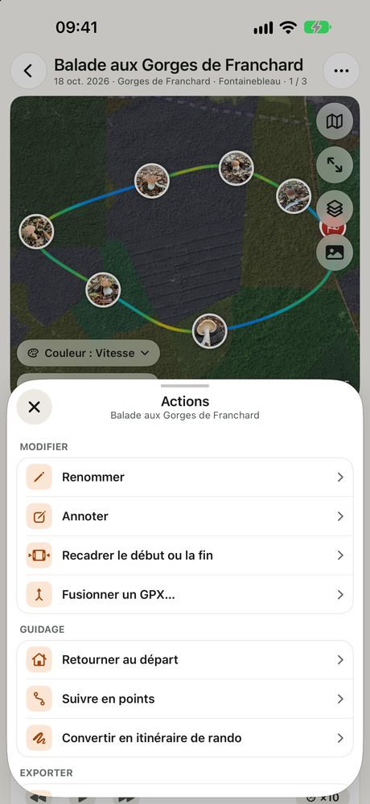<figcaption>Acties: hernoemen, bijsnijden, samenvoegen, omzetten.</figcaption></figure>

## Wandelingen

Een catalogus met bijna 38.000 routes in Frankrijk (OpenStreetMap, IGN) is in de app ingebouwd en offline te raadplegen: afstand, hoogteverschil, hoogteprofiel, duur en moeilijkheid, berekend door de app en uitsluitend ter informatie.

- **Zoeken op plaats en filters** op de routes van een gebied, op een kaart en in een lijst.
- **Starten**: SnapSpot neemt je wandeling op en leidt je langs de route, met gesproken aanwijzingen bij de bochten en een melding als je het pad verlaat. De opname kun je uitschakelen.
- **Mijn routes**: teken je eigen route met de hand of punt voor punt, aangesloten op de paden van het IGN-netwerk (netwerk nodig), en deel hem met een andere iPhone of exporteer hem als GPX.

<figure>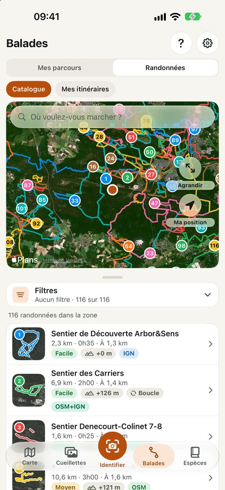<figcaption>De catalogus, op een kaart en in een lijst.</figcaption></figure>
<figure>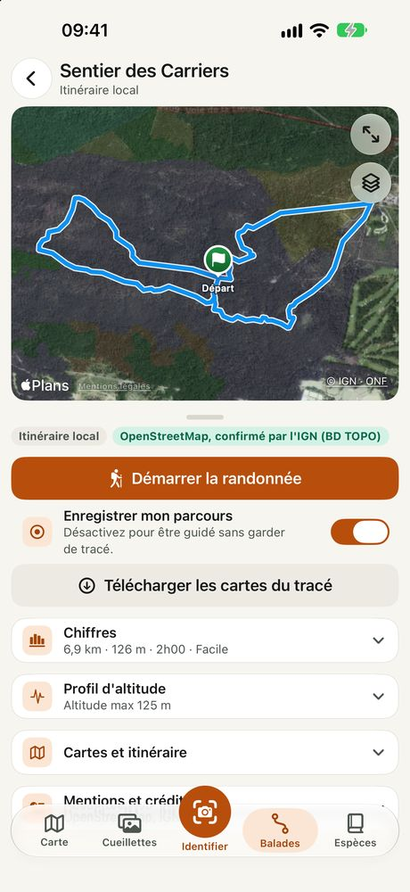<figcaption>Een route: cijfers, hoogteprofiel, te downloaden kaarten.</figcaption></figure>
<figure>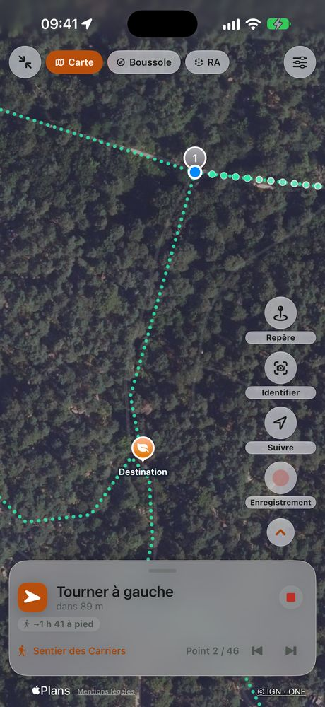<figcaption>Starten: opname en navigatie samen.</figcaption></figure>

## Een eenvoudige interface die zich aanpast aan jou

De interface van SnapSpot is opnieuw ontworpen rond hoe je een telefoon in het bos gebruikt: één hand, weinig tijd, soms weinig bereik.

- **Vijf tabbladen**: Kaart, Vondsten, Determineer (de grote knop in het midden), Tochten en Soorten.
- **Eenvoudig of Expert**: in Eenvoudig zijn details achter een kleine knop ingeklapt, in Expert uitgeklapt. Alle functies en alle gegevens blijven in beide beschikbaar, en veiligheidswaarschuwingen worden nooit ingeklapt. Je kunt altijd wisselen.
- **Licht of donker, staand of liggend**: de interface volgt de iPhone, en de schermstand kun je in de instellingen vastleggen.
- **Ingebouwde hulp**: een rondleiding, een helpcentrum per thema met illustraties en tips die maar één keer verschijnen.

<figure>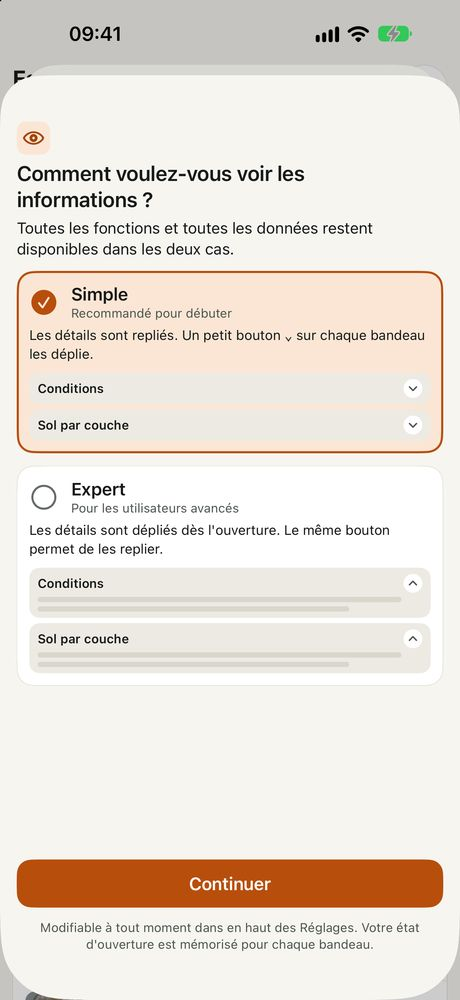<figcaption>Weergave: Eenvoudig of Expert.</figcaption></figure>
<figure>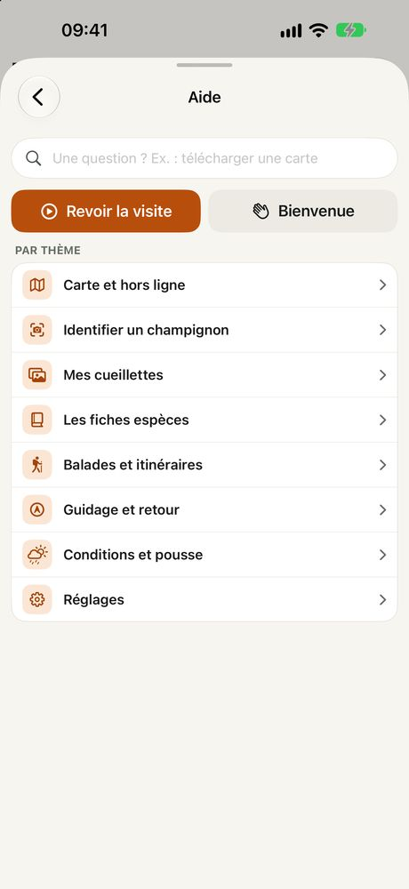<figcaption>Een helpcentrum, per thema.</figcaption></figure>
<figure>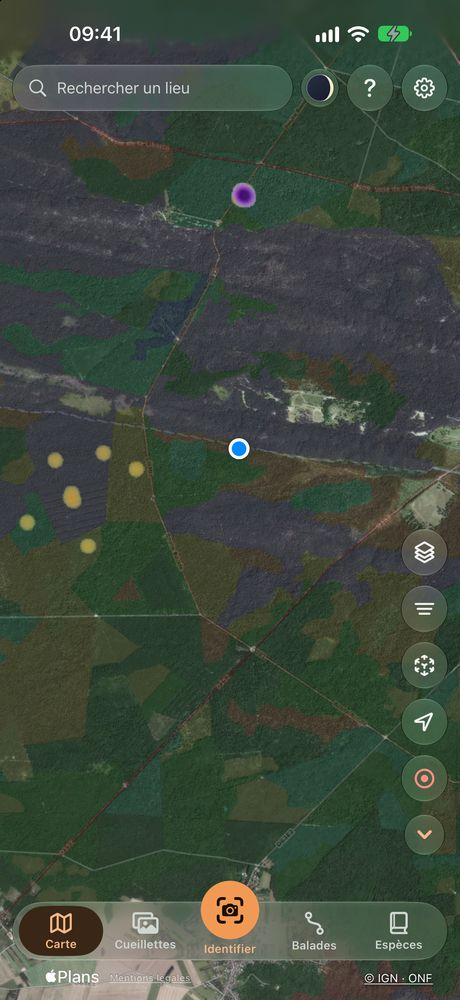<figcaption>De donkere modus.</figcaption></figure>

<figure>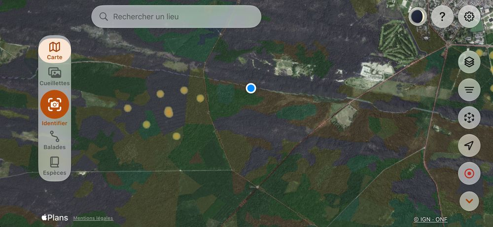<figcaption>Liggend worden de tabbladen een zijbalk.</figcaption></figure>
<figure>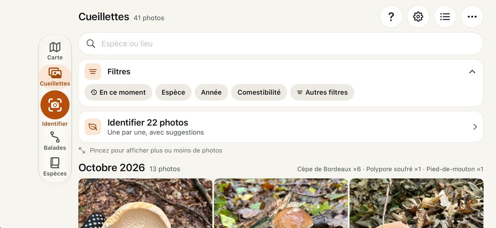<figcaption>Het tabblad Vondsten liggend.</figcaption></figure>

## Absolute privacy

- **Geen SnapSpot-server, geen account, geen reclame, geen tracking, geen gebruiksstatistieken.**
- Je foto's, spots, routes en analyses **blijven op je iPhone**. Wij kunnen ze niet zien, zelfs als we dat zouden
  willen.
- Determinatie, beschrijving en navigatie gebeuren **op het apparaat**.
- Alleen openbare kaart- en weerdiensten worden benaderd (IGN-kaarten, plaatsnamen, het zoeken naar een plaats, regen
  van de afgelopen 14 dagen), zoals bij elke webpagina, zonder ooit je foto's of spots te versturen. Vooraf
  gedownloade kaarten werken zonder netwerk.
- Je paddenstoelenplekjes zijn van jou: ze verlaten de iPhone alleen als je ze zelf deelt.

## Ook in de app

- **Veldaanwijzingen**: noteer geur, vlees, biotoop of sporenafdruk, met dicteren of uit suggesties. Ze wegen mee in
  de voorstellen en in een vergelijkend oordeel van Apple Intelligence, dat je opnieuw kunt starten.
- **Zoeken op de kaart**: een plaats, een adres, coördinaten, of een van je vondsten, een route, een markering.
- **Regen en maan**: de regen van de afgelopen 14 dagen en de bodemvochtigheid op de kaart “Hier”, en de maanfase van
  vandaag, uitsluitend ter informatie.
- **Groeiomstandigheden**: een indicatieve index op basis van regen, bodemvocht en bodemtemperatuur (netwerk nodig), nooit een belofte van oogst.
- **Delen vanuit Foto's**: het deelvenster van de iPhone stuurt foto's naar SnapSpot, dat hun locatie leest.
- **Exporteren en overdragen**: GPX, spots, routes met hun foto's, of je hele verzameling naar een andere iPhone via
  AirDrop.
- **Gezondheid-app**: je wandelingen kunnen daar als wandeltochten worden opgeslagen (alleen schrijven).
- **Soortkaarten**: meer dan 200, met seizoenen, biotopen, rechtenvrije foto's en bronvermelding.
- **Negen talen**: Frans, Engels, Duits, Spaans, Italiaans, Portugees, Nederlands, Pools en Zweeds.

[Privacybeleid](privacy) · [Ondersteuning](support) · Contact: snapspot.app@outlook.com
