

# SnapSpot: Paddenstoelen {:.no_toc}

Jouw plekjes. Jouw vondsten. Alleen van jou.

**Verken de bossen, determineer je vondsten, vind je beste spots terug.** De veldgids voor paddenstoelenzoekers,
voor iPhone. Ook zonder netwerk.

<small class="soon">Binnenkort</small>

<ul class="badges">
<li>Werkt zonder netwerk</li>
<li>Geen account</li>
<li>Geen reclame</li>
<li>Je gegevens blijven op je iPhone</li>
</ul>

## Verkennen. Determineren. Onthouden. Terugvinden. {:.no_toc}

<figure>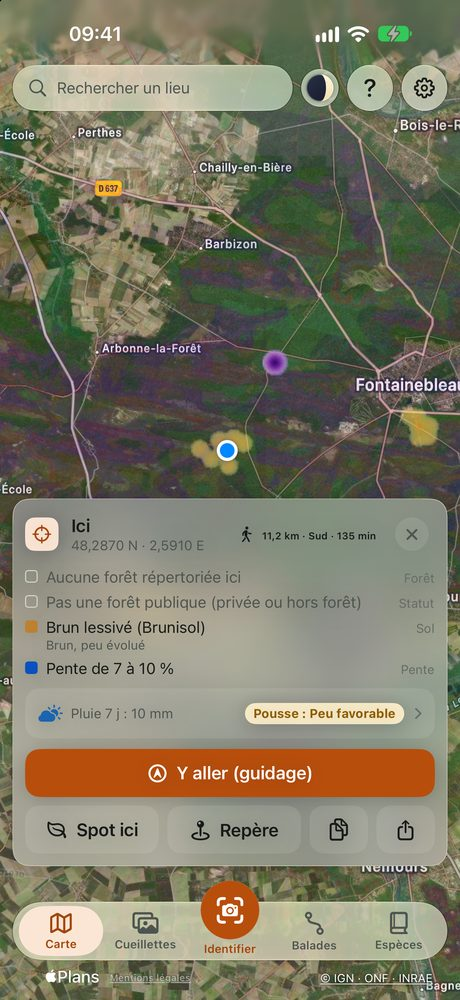<figcaption><b>1. Verkennen</b> Boskaart, openbare bossen, bodemkaart, hellingen, reliëf, kadaster: de IGN-kaarten helpen gunstige habitats te vinden. Een lange druk toont wat elke laag hier laat zien; download ze voor je vertrekt.</figcaption></figure>
<figure>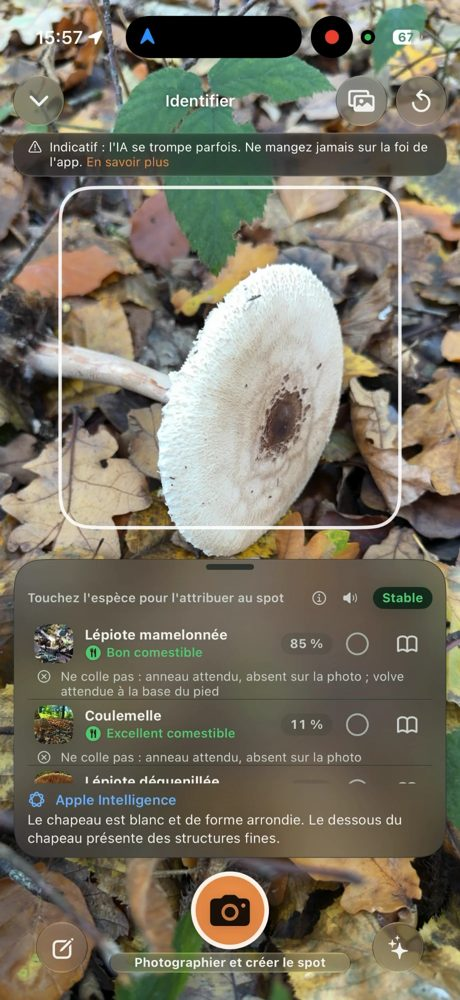<figcaption><b>2. Determineren</b> Een model gemaakt voor paddenstoelen, op de iPhone, zonder netwerk. Meerdere voorstellen, gevaarlijke verwisselingen aangegeven, nooit een oordeel.</figcaption></figure>
<figure>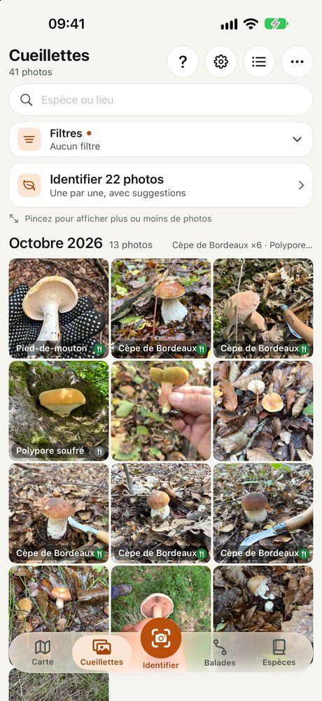<figcaption><b>3. Onthouden</b> Elke foto met locatie wordt een spot. Sorteer per soort, vind terug per seizoen, jaar of eetbaarheid en zet markeringen: auto, bosingang, doorgang.</figcaption></figure>
<figure>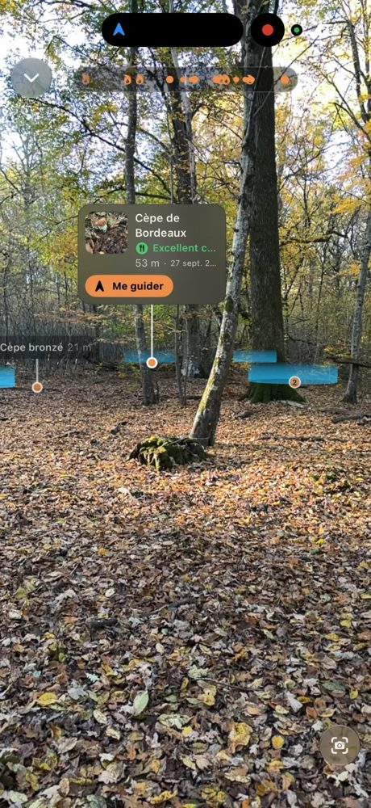<figcaption><b>4. Terugvinden</b> Kaart, kompas of augmented reality tot aan de spot, met geluiden en trillingen als de telefoon in je zak blijft. Je wandelingen worden opgenomen.</figcaption></figure>

*SnapSpot bestaat in een lichte en een donkere modus en volgt de instelling van uw iPhone, dus de schermafbeeldingen op deze pagina wisselen tussen beide.*

<nav class="toc" markdown="1">

Inhoud

* TOC
{:toc}

</nav>

**SnapSpot is geen kaart van plukgebieden.** De app zegt je niet waar je heen moet: ze helpt je te verkennen en
bewaart daarna het geheugen van je eigen plekjes. Paddenstoelen komen jaar na jaar terug, op dezelfde plek en in
dezelfde periode: de spots van gisteren bereiden het seizoen van morgen voor.

## Verkennen

De IGN-kaarten worden vooraf gedownload: luchtfoto's, plattegrond, reliëf, boskaart, openbare bossen, oude bossen,
kadaster, hellingen, waterlopen, hoogtelijnen, geologie. Een lange druk op de kaart zegt wat de laag op die plek
toont.

- **Bodemkaart (INRAE)** naast de boslagen: het bodemtype is met de legenda af te lezen met een lange druk.
- **Elke laag heeft zijn eigen transparantie**, en met een algemene schuif kijk je door de lagen heen naar de satellietfoto.

<figure>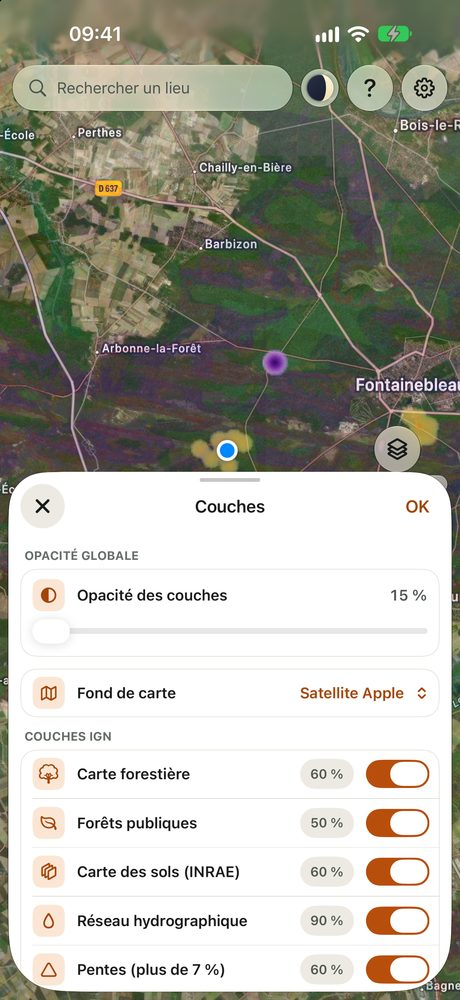<figcaption>Het blad Lagen: algemene dekking, achtergrondkaart en de IGN-lagen per rubriek, elk met eigen transparantie.</figcaption></figure>
<figure><figcaption>Een lange druk: wat de lagen hier tonen (bos, status, bodem, helling), regen van 7 dagen, «Groei: weinig gunstig» en «Ga erheen».</figcaption></figure>
<figure>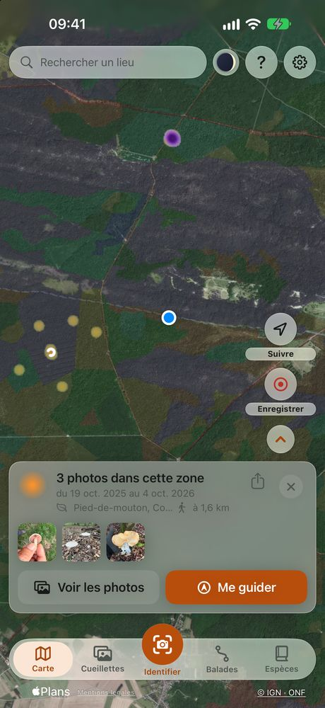<figcaption>Een zone: de 3 foto's van dezelfde plek, met «Foto's bekijken» en «Leid me».</figcaption></figure>

<figure>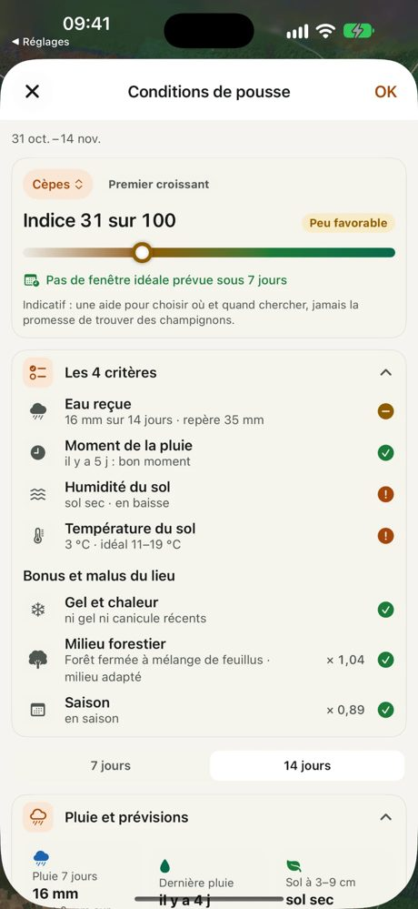<figcaption>Groeiomstandigheden van een vondst: index 31 op 100, de 4 criteria (water, moment van de regen, bodemvocht en -temperatuur), dan de bonussen en maluspunten van de plek.</figcaption></figure>
<figure>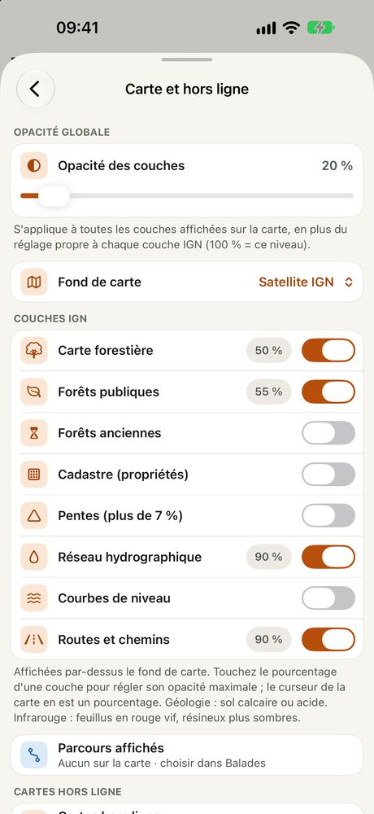<figcaption>Instellingen › Kaart en offline: achtergrondkaart, dekking van de lagen en lagen per rubriek (bos en vegetatie, bodem en water, reliëf en hellingen).</figcaption></figure>
<figure>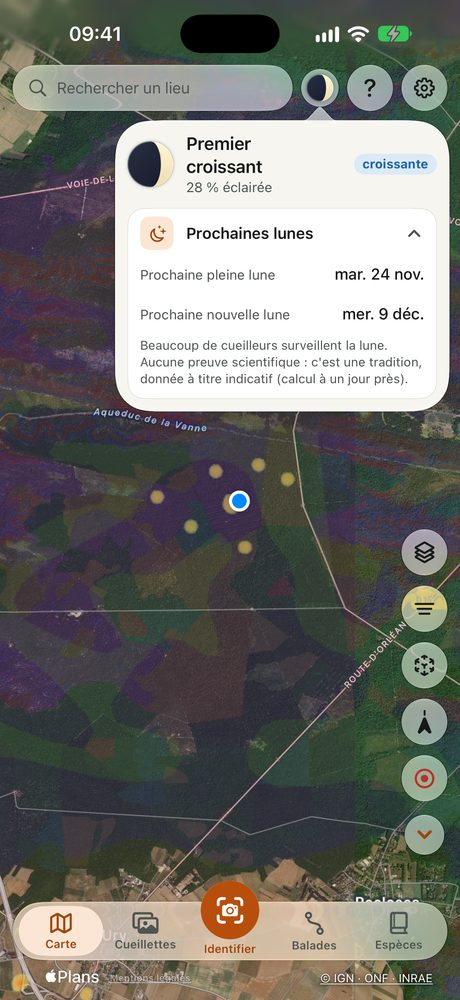<figcaption>De maanfase (hier de eerste sikkel) en de komende manen, uitsluitend ter informatie.</figcaption></figure>

### Is het een goed moment om te plukken?

SnapSpot analyseert het weer van de afgelopen en komende dagen op de plek: regen, bodemvocht en -temperatuur, seizoen, leefgebied. Daaruit komt een **groeiomstandighedenindex** en op compatibele iPhones **schrijft Apple Intelligence een begrijpelijke duiding**: zijn de omstandigheden gunstig, waarom, en wanneer je er weer op uit kunt.

- **Geschreven op je iPhone**: de tekst wordt door de iPhone zelf geschreven, er wordt niets verstuurd. Alleen openbare weergegevens worden gedownload.
- **Opnieuw, voorlezen, automatisch voorlezen**: een andere formulering met één tik, of hardop voorlezen.
- **Indicatief, nooit een belofte**: een hulp om te kiezen waar en wanneer je zoekt, zonder ooit te zeggen of een paddenstoel eetbaar is.

<figure>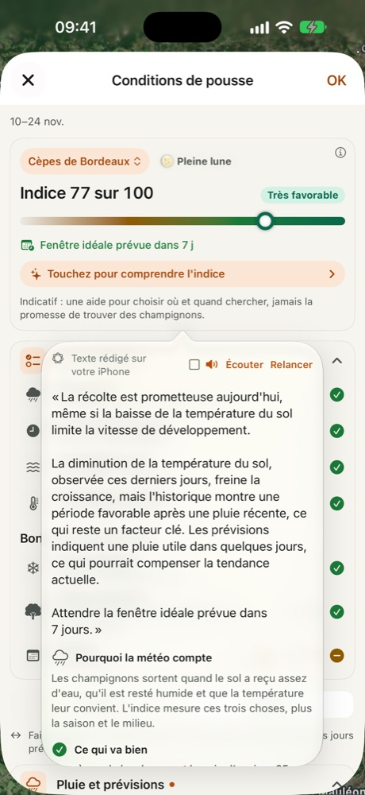<figcaption>De groei-index en de door Apple Intelligence geschreven duiding: „Plukken ziet er vandaag veelbelovend uit… wacht op het ideale venster dat over 7 dagen wordt verwacht”.</figcaption></figure>

## Determineren, met een model gemaakt voor paddenstoelen

De determinatie berust op een **gespecialiseerd model**, getraind op duizenden foto's van Franse paddenstoelen en
ingebouwd in de app. Het is gebaseerd op BioCLIP, een model voor het herkennen van levende wezens van het Imageomics
Institute.

<video src="../images/identification-direct.mp4" poster="../images/identification-direct-poster.jpg" controls muted playsinline preload="none"></video>

*Live: de app analyseert waar de camera op gericht is, stelt soorten voor, geeft gevaarlijke verwisselingen aan en
maakt dan de spot aan.*

- **Meer dan 200 soorten.** De app kent ze niet allemaal: sommige dodelijke soorten ontbreken bij gebrek aan foto's,
  en de app herinnert je daaraan.
- **Op onze testfoto's** staat de juiste soort in ongeveer 9 van de 10 gevallen bovenaan, en in bijna 98 % van de
  gevallen bij de eerste drie voorstellen. De app toont altijd meerdere voorstellen en de te controleren kenmerken,
  nooit een oordeel.
- **Live** met de camera, of op foto's die je al genomen hebt.
- **Alles op de iPhone**: er gaat geen enkele afbeelding het internet op, en het werkt midden in het bos, zonder
  netwerk.
- **Apple Intelligence** (compatibele iPhones) levert alleen een beschrijving van wat de foto toont, vergeleken met
  de kenmerken van de soortkaart. Het noemt nooit de soort: de voorstellen komen van het SnapSpot-model.
- **Giftige of dodelijke soorten worden altijd aangegeven.** Je kunt niet-eetbare soorten ook van de kaart
  verbergen.

<figure>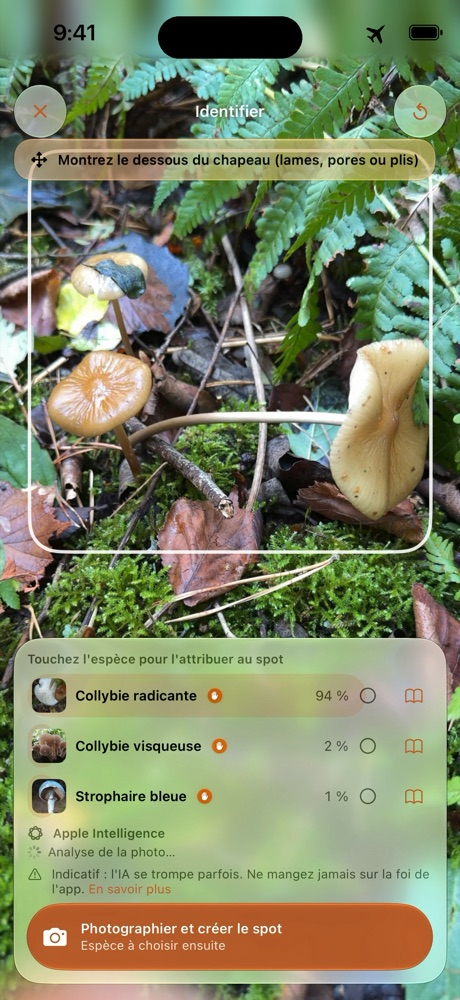<figcaption>In vliegtuigmodus werkt alles.</figcaption></figure>
<figure>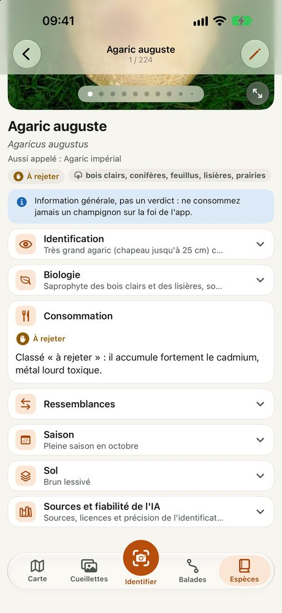<figcaption>Een kaart per soort, offline te raadplegen.</figcaption></figure>
<figure>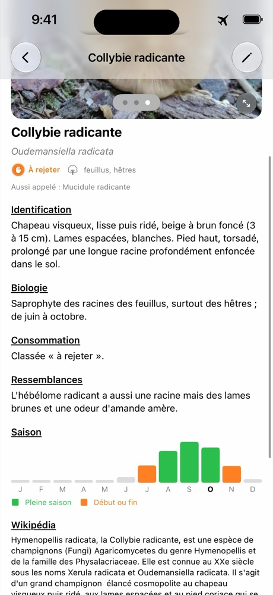<figcaption>Het seizoen van elke soort.</figcaption></figure>

<figure>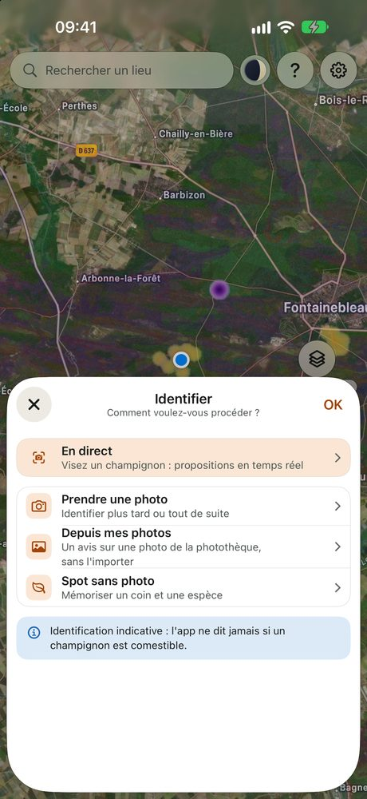<figcaption>Determineer: live, een foto nemen, vanaf je foto's of een spot zonder foto.</figcaption></figure>
<figure>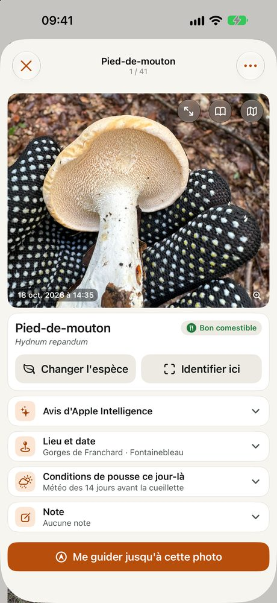<figcaption>Een vondst: foto, soort en eetbaarheid, plaats en datum, groeiomstandigheden, oordeel van Apple Intelligence en «Leid me».</figcaption></figure>
<figure>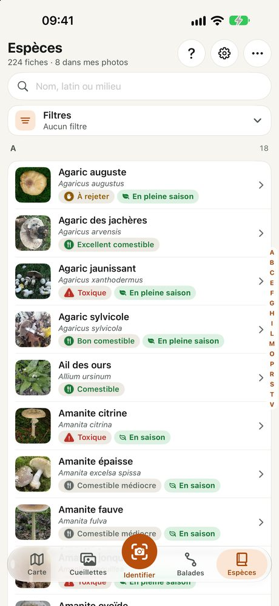<figcaption>De catalogus: 224 fiches, zoeken, filters, seizoen en eetbaarheid van elke soort.</figcaption></figure>

<figure><figcaption>Live determineren: zoekerkader, voorstellen en beschrijving van Apple Intelligence.</figcaption></figure>
<figure>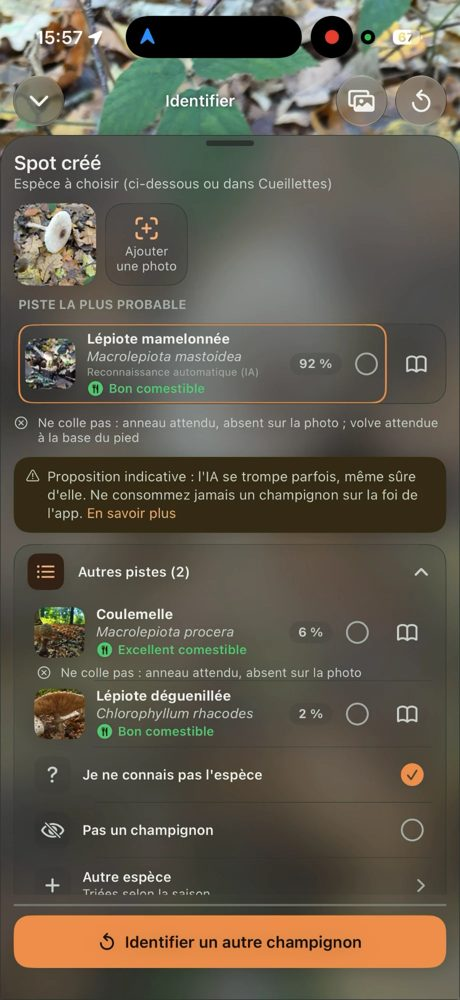<figcaption>Na de foto is de spot aangemaakt: meest waarschijnlijke voorstel, andere voorstellen en een waarschuwing. De soort kies je zelf.</figcaption></figure>

> **Belangrijk**: de determinatie is indicatief en kan fout zijn. Eet nooit een paddenstoel op basis van de app: laat
> hem controleren door een apotheker of een mycologische vereniging.

## Je vondsten onthouden

Elke foto met locatie wordt een spot. Blader erdoorheen als raster of lijst, filter op periode, soort, jaar of eetbaarheid, groepeer de foto's van dezelfde paddenstoel, zet markeringen (auto, waterpunt, hut, opvallende boom, uitkijkpunt) en voeg foto's toe uit je bibliotheek, een album of een andere iPhone. Elke foto bewaart zijn plaats, zijn datum, het weer van de voorgaande dagen en een indicatieve index van de groeiomstandigheden.

<figure>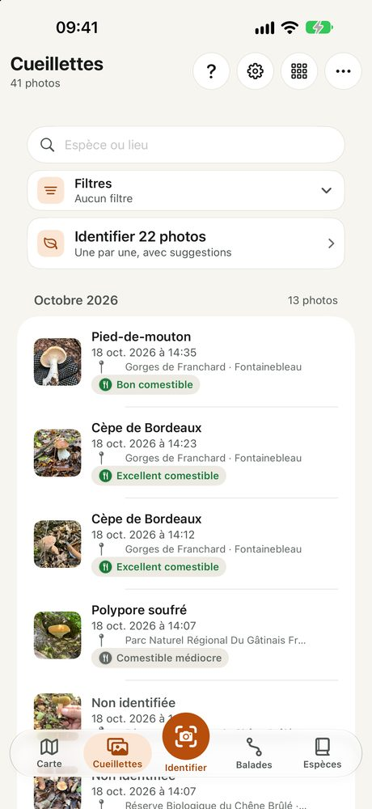<figcaption>De lijst: foto, datum, plaats, soort en eetbaarheid van elke vondst.</figcaption></figure>
<figure>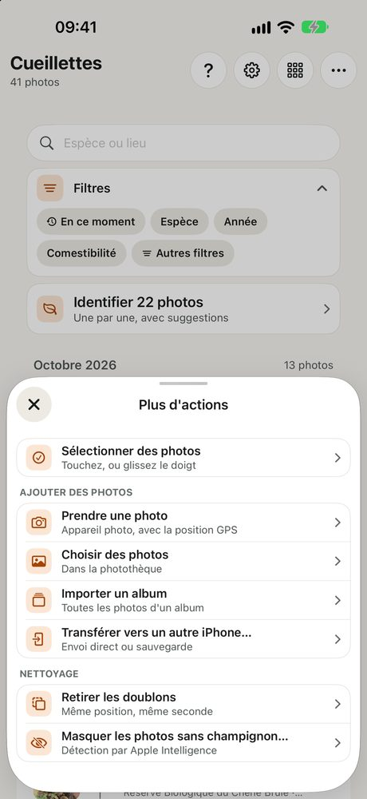<figcaption>Meer acties: foto's toevoegen (camera, bibliotheek, album, andere iPhone) en opruimen (dubbels, foto's zonder paddenstoel).</figcaption></figure>
<figure>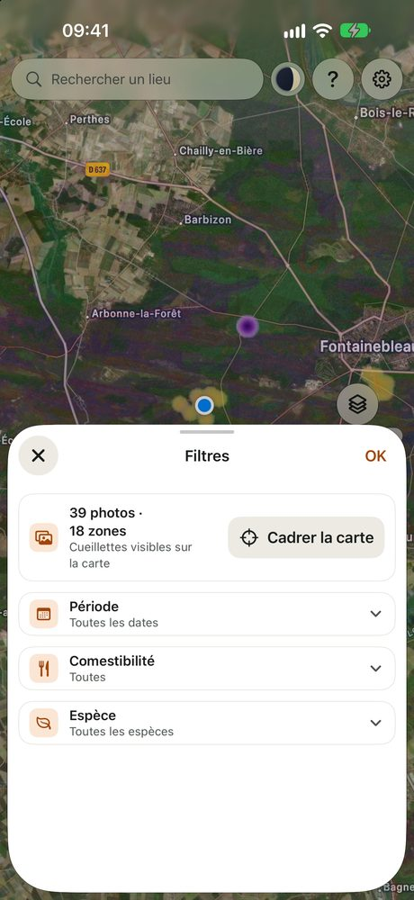<figcaption>Kaartfilters: periode, eetbaarheid, soort en «Kaart centreren» op je vondsten.</figcaption></figure>

### Wandelen en je eigen routes maken

- **GPS-registratie** van je wandelingen: afstand, hoogteverschil, snelheid, pauzes en markeringen, ook met vergrendeld scherm.
- **Je eigen routes**: koppel je vondsten of zet punten op de kaart, en SnapSpot leidt je van punt naar punt.
- **Terug naar de start** in rechte lijn, langs je eigen spoor of over paden. Alleen „Via de paden” raadpleegt de routedienst van het IGN, met je positie en de bestemming, nooit je foto's of spots.
- **Opnamelade**: duur, afstand, snelheid en markeringen in één oogopslag, pauze, stop en «Terug naar de start» onder je duim.
- **Autodetectie**: vergeet je de opname in de auto te stoppen, dan stelt SnapSpot voor het einde van de tocht af te knippen.
- **Zonsondergangsherinnering**: een melding wanneer het tijd is om terug te keren, zodat de nacht je niet verrast.

<figure>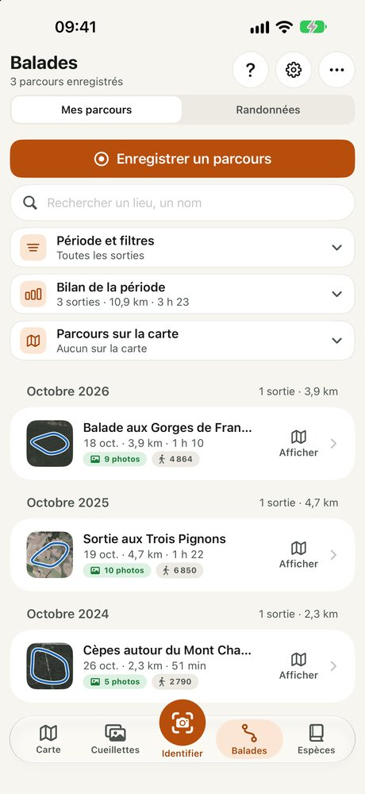<figcaption>Tochten: je tracks per datum, met het overzicht van de periode en het aantal foto's van elk.</figcaption></figure>
<figure>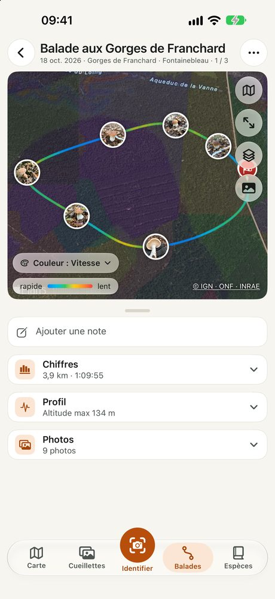<figcaption>Een tocht: track gekleurd op snelheid, miniaturen van de genomen foto's, cijfers en profiel.</figcaption></figure>
<figure>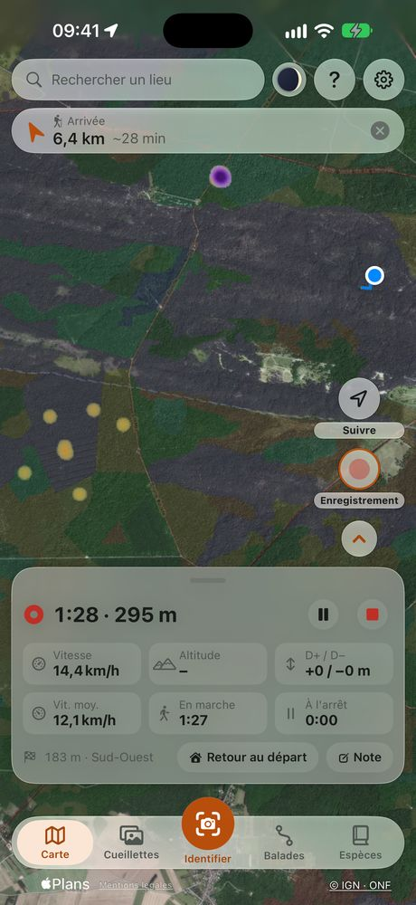<figcaption>De lopende opname: duur, afstand, snelheid, hoogteverschil en «Terug naar de start».</figcaption></figure>

<figure>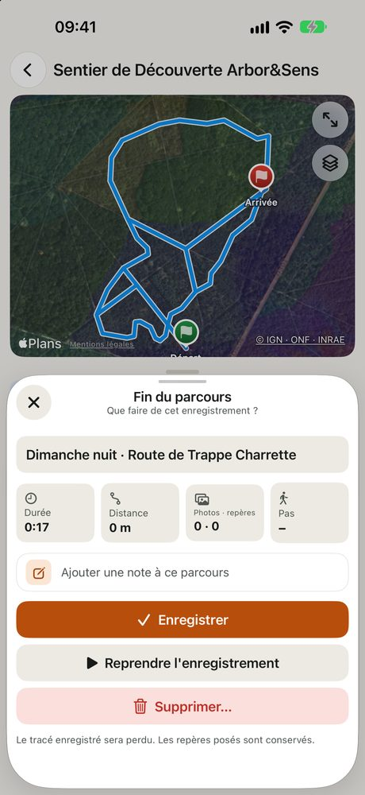<figcaption>Einde van een tocht: bewaren, opname hervatten of verwijderen.</figcaption></figure>
<figure>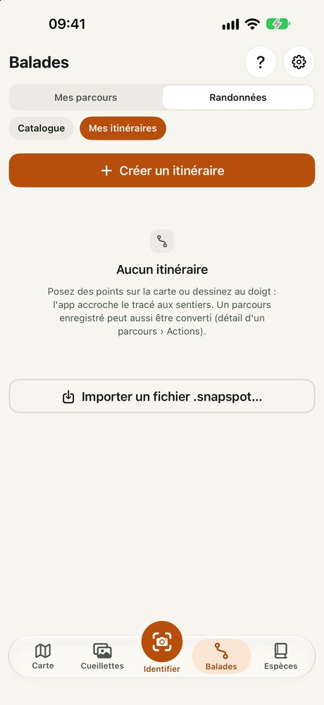<figcaption>Mijn routes: een route maken, met je vinger tekenen of een .snapspot-bestand importeren.</figcaption></figure>
<figure>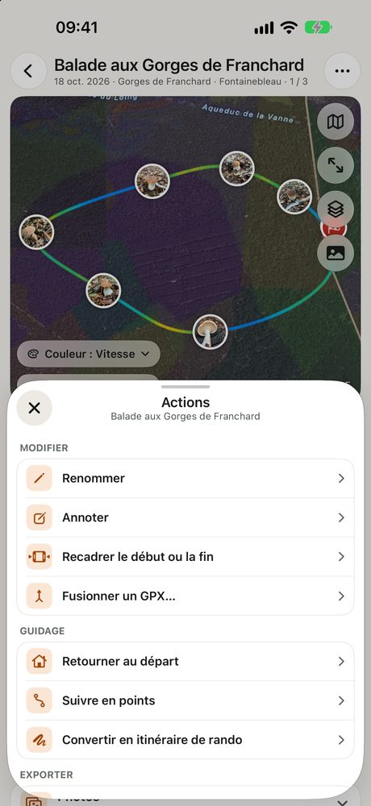<figcaption>Acties van een tocht: hernoemen, aantekening, bijsnijden, GPX samenvoegen; terug naar de start, op punten volgen, omzetten in route.</figcaption></figure>

## Een spot terugvinden

De navigatie brengt je te voet naar een spot: afstand, richting, looptijd en in augmented reality een sonar op de
grond die het gebied toont. Bij vergrendeld scherm vertellen piepjes en trillingen of je de goede kant op gaat, en een
stem kan je koers corrigeren.

<video src="../images/guidage-ra.mp4" poster="../images/guidage-ra-poster.jpg" controls muted loop playsinline preload="none"></video>

*De sonar: een golf vertrekt vanaf de spot en verbreedt zich over de grond, op de werkelijke grootte van het gebied,
om de afstand in te schatten.*

- **Drie weergaven**: kaart, radarkompas of augmented reality, met een lade die je omhoog trekt voor details of minimaliseert om de kaart in het oog te houden.
- **Meerdere punten achter elkaar**: koppel spots tot een route, of zet punten op de kaart en laat SnapSpot je van het ene naar het volgende leiden.

<figure>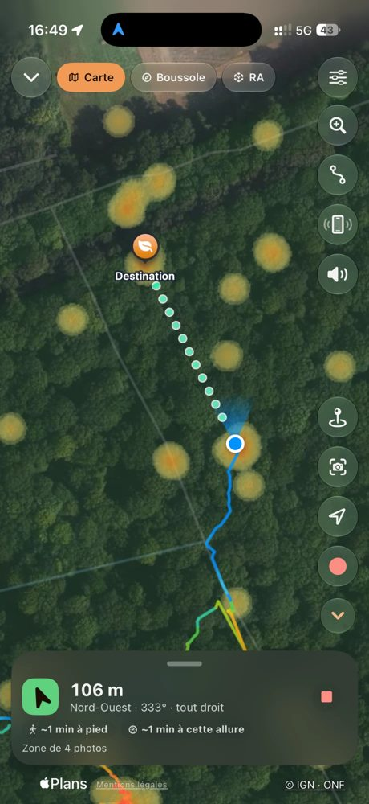<figcaption>De begeleiding op de kaart: het stippelpad leidt naar het gebied met 4 foto's, 106 m verderop.</figcaption></figure>
<figure><figcaption>In augmented reality verschijnt op 53 m een oude eekhoorntjesbrood-spot, met „Leid me”.</figcaption></figure>
<figure>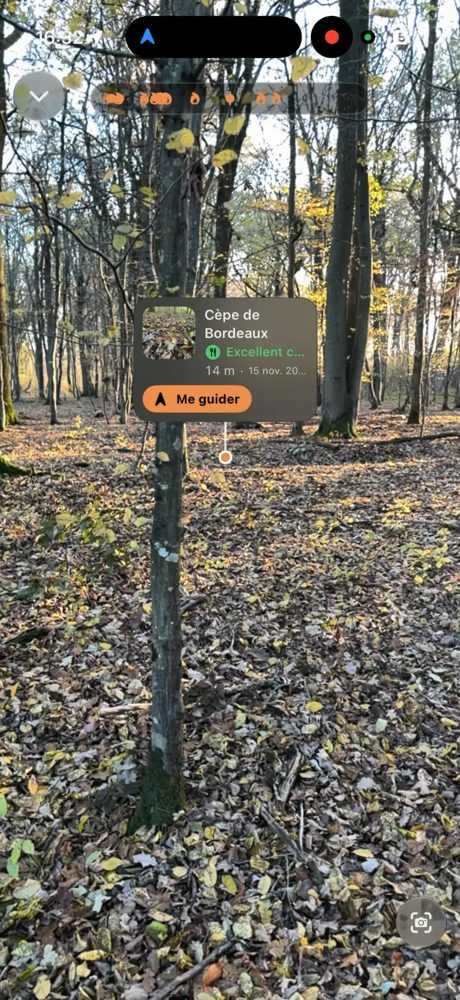<figcaption>Op 14 m nog een oude eekhoorntjesbrood-spot: de kaart toont de soort, eetbaarheid en datum.</figcaption></figure>

<figure>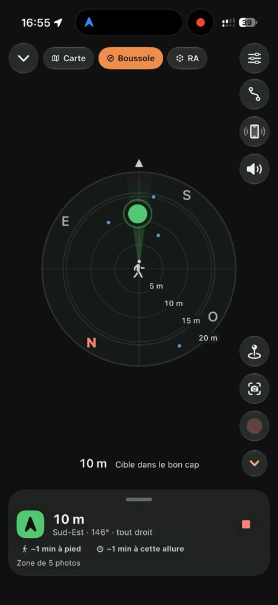<figcaption>Navigatie in kompasmodus: radar van de vondsten om je heen, richting en looptijd in de lade.</figcaption></figure>
<figure>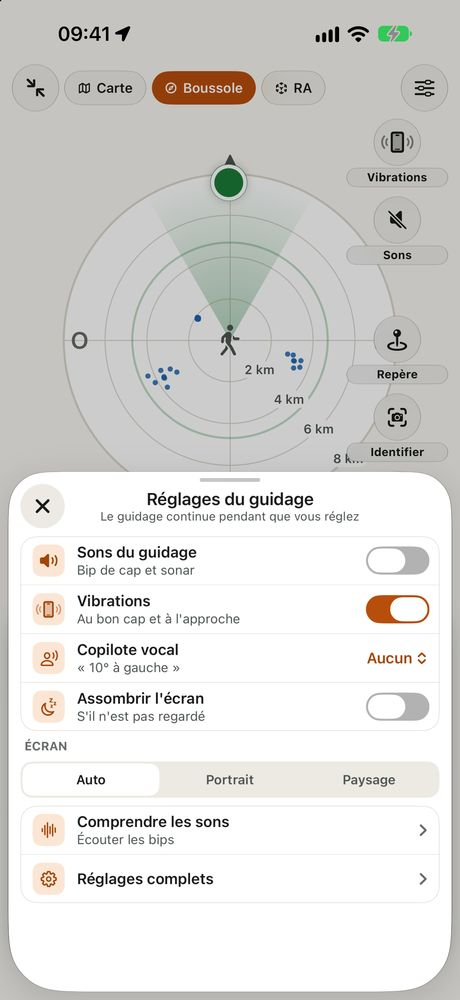<figcaption>Snelle navigatie-instellingen: geluiden, trillingen, gesproken copiloot en schermstand.</figcaption></figure>
<figure>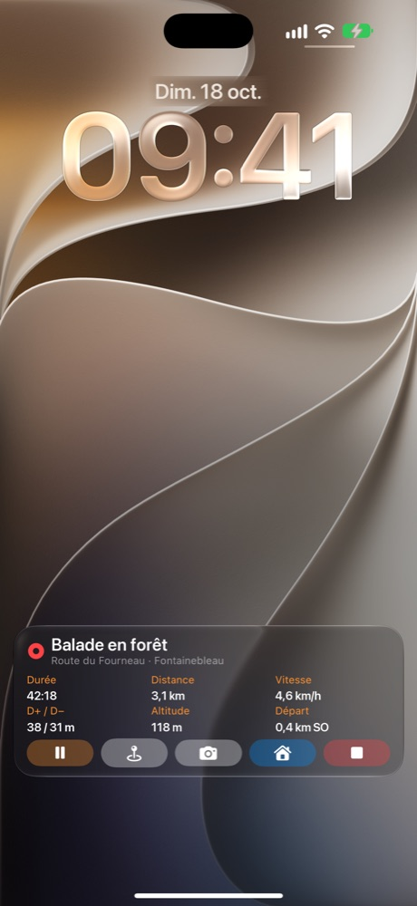<figcaption>Je wandeling op het vergrendelscherm.</figcaption></figure>

<figure>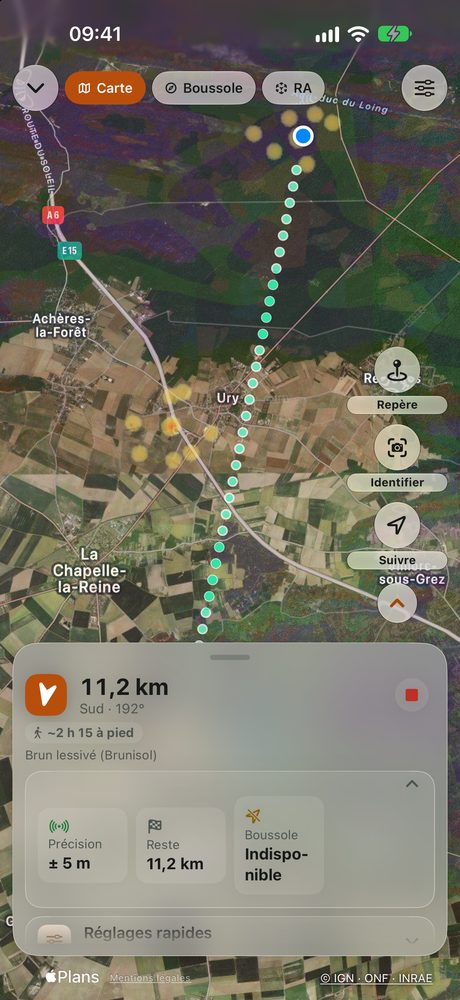<figcaption>De uitgeklapte lade in kaartmodus: volgende bocht, nauwkeurigheid, resterende afstand en volgende punten.</figcaption></figure>
<figure>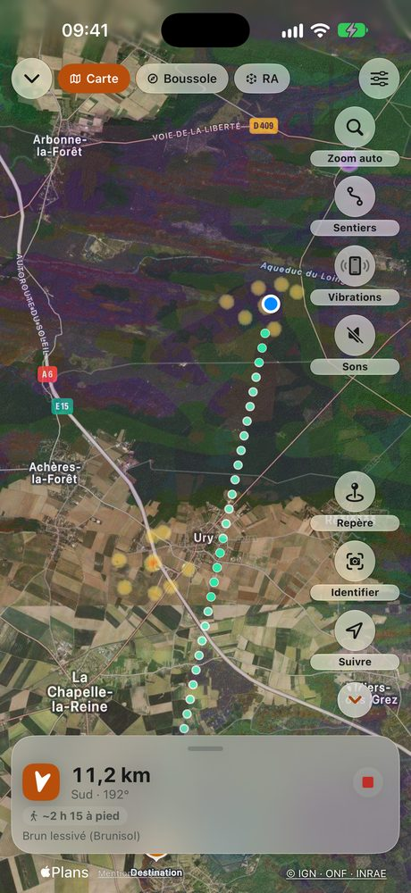<figcaption>De uitgeklapte knoppenkolom: trillingen, geluiden, markering, determineer, opname.</figcaption></figure>
<figure>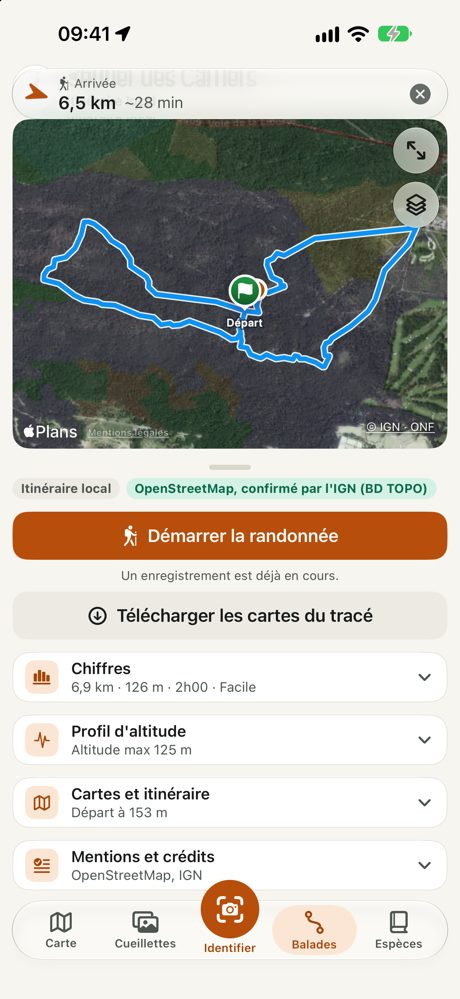<figcaption>De geminimaliseerde navigatie: alleen een balk bovenaan terwijl je de routekaart bekijkt.</figcaption></figure>

*Schermafbeeldingen gemaakt met demonstratiegegevens.*

## Wandelingen

Een catalogus met bijna 38.000 routes in Frankrijk (OpenStreetMap, IGN) is in de app ingebouwd en offline te raadplegen: afstand, hoogteverschil, hoogteprofiel, duur en moeilijkheid, berekend door de app en uitsluitend ter informatie.

- **Zoeken op plaats en filters** op de routes van een gebied, op een kaart en in een lijst.
- **Starten**: SnapSpot neemt je wandeling op en leidt je langs de route, met gesproken aanwijzingen bij de bochten en een melding als je het pad verlaat. De opname kun je uitschakelen.
- **Mijn routes**: teken je eigen route met de hand of punt voor punt, aangesloten op de paden van het IGN-netwerk (netwerk nodig), en deel hem met een andere iPhone of exporteer hem als GPX.

<figure>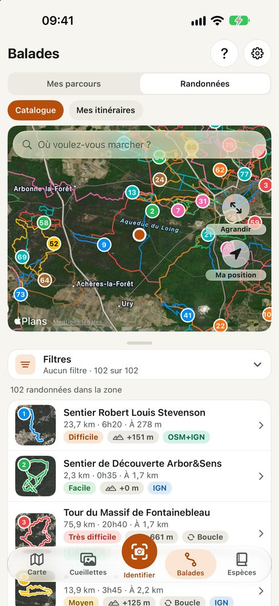<figcaption>De wandelcatalogus: kaart en lijst met afstand, hoogteverschil, moeilijkheid en bron van elke route.</figcaption></figure>
<figure>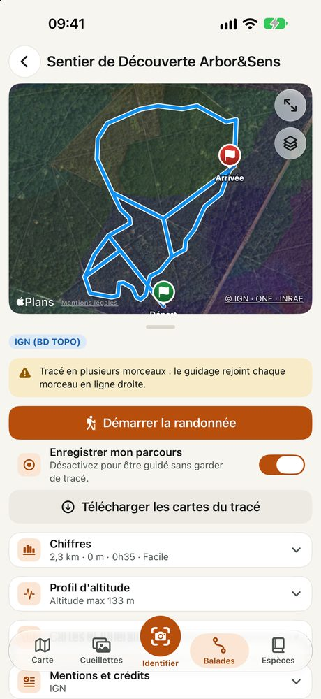<figcaption>Routekaart: «Starten», kiezen of je opneemt, te downloaden kaarten, cijfers en hoogteprofiel.</figcaption></figure>
<figure>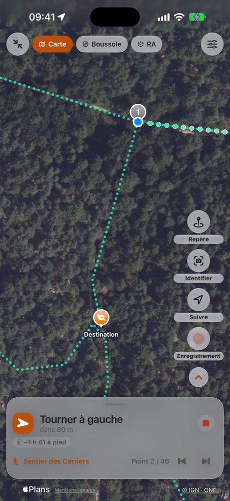<figcaption>Begeleide wandeling: aanwijzing «Linksaf» en stippellijn naar het volgende punt.</figcaption></figure>

## Een eenvoudige interface die zich aanpast aan jou

De interface van SnapSpot is opnieuw ontworpen rond hoe je een telefoon in het bos gebruikt: één hand, weinig tijd, soms weinig bereik.

- **Vijf tabbladen**: Kaart, Vondsten, Determineer (de grote knop in het midden), Tochten en Soorten.
- **Eenvoudig of Expert**: in Eenvoudig zijn details achter een kleine knop ingeklapt, in Expert uitgeklapt. Alle functies en alle gegevens blijven in beide beschikbaar, en veiligheidswaarschuwingen worden nooit ingeklapt. Je kunt altijd wisselen.
- **Licht of donker, staand of liggend**: de interface volgt de iPhone, en de schermstand kun je in de instellingen vastleggen.
- **Ingebouwde hulp**: een rondleiding, een helpcentrum per thema met illustraties en tips die maar één keer verschijnen.

<figure>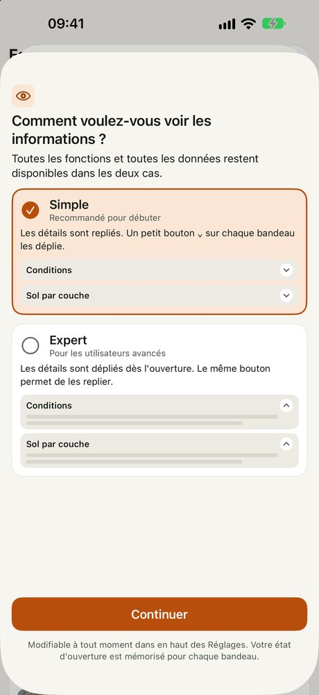<figcaption>Eenvoudig of Expert: dezelfde functies en gegevens, details in- of uitgeklapt.</figcaption></figure>
<figure>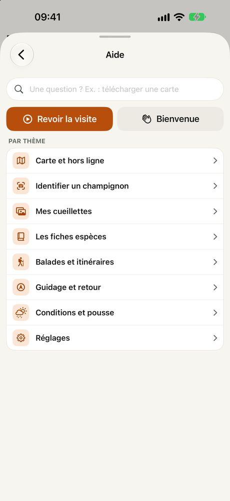<figcaption>Het helpcentrum: rondleiding en thema's (kaart, determinatie, vondsten, tochten, navigatie …).</figcaption></figure>
<figure>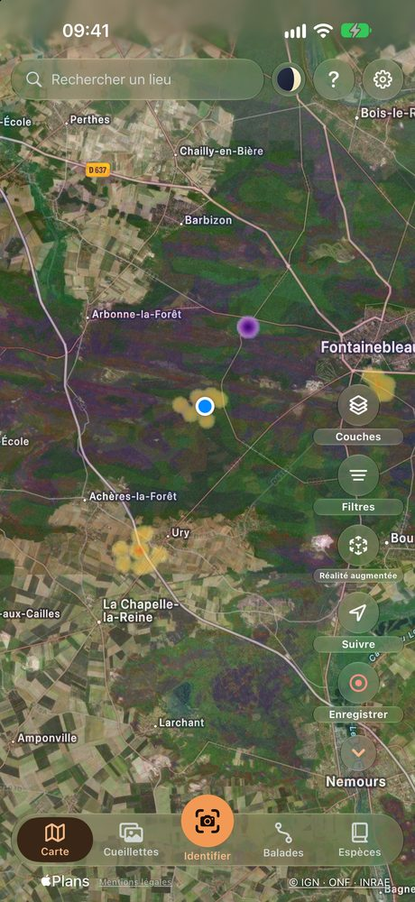<figcaption>De donkere modus op de kaart: dezelfde interface, aangepaste kleuren.</figcaption></figure>

<figure>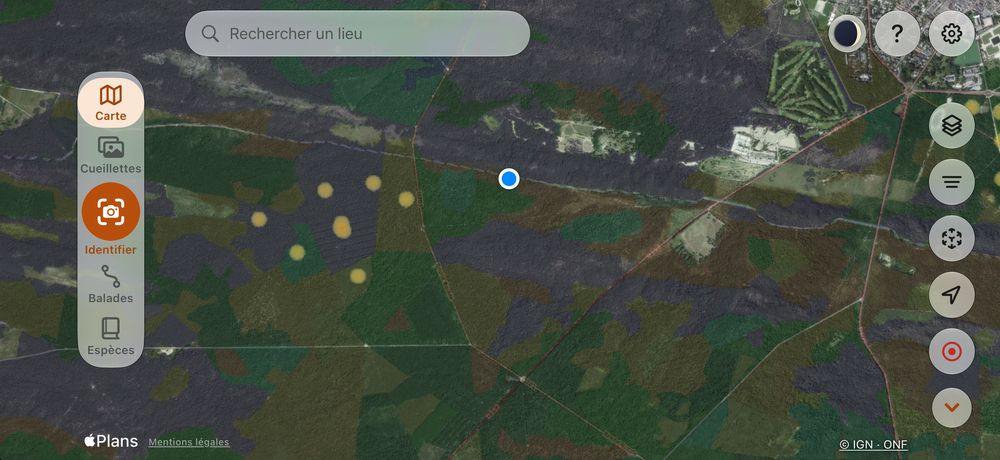<figcaption>De kaart liggend: tabbladen als zijbalk links, knoppen rechts.</figcaption></figure>
<figure>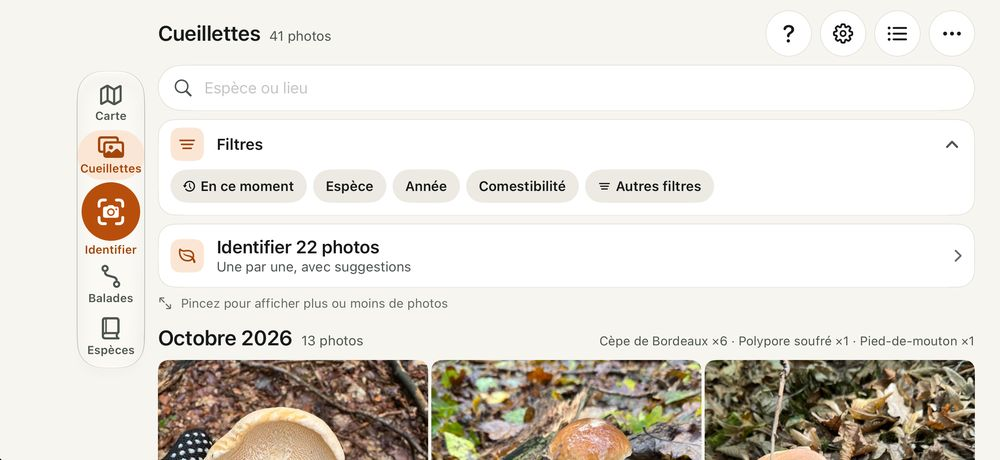<figcaption>Het tabblad Vondsten liggend, met filterchips.</figcaption></figure>

## Absolute privacy

- **Geen SnapSpot-server, geen account, geen reclame, geen tracking, geen gebruiksstatistieken.**
- Je foto's, spots, routes en analyses **blijven op je iPhone**. Wij kunnen ze niet zien, zelfs als we dat zouden
  willen.
- Determinatie, beschrijving en navigatie gebeuren **op het apparaat**.
- Alleen openbare kaart- en weerdiensten worden benaderd (IGN-kaarten, plaatsnamen, het zoeken naar een plaats, regen
  van de afgelopen 14 dagen), zoals bij elke webpagina, zonder ooit je foto's of spots te versturen. Vooraf
  gedownloade kaarten werken zonder netwerk.
- Je paddenstoelenplekjes zijn van jou: ze verlaten de iPhone alleen als je ze zelf deelt.

## Ook in de app

- **Veldaanwijzingen**: noteer geur, vlees, biotoop of sporenafdruk, met dicteren of uit suggesties. Ze wegen mee in
  de voorstellen en in een vergelijkend oordeel van Apple Intelligence, dat je opnieuw kunt starten.
- **Zoeken op de kaart**: een plaats, een adres, coördinaten, of een van je vondsten, een route, een markering.
- **Regen en maan**: de regen van de afgelopen 14 dagen en de bodemvochtigheid op de kaart “Hier”, en de maanfase van
  vandaag, uitsluitend ter informatie.
- **Groeiomstandigheden**: een indicatieve index op basis van regen, bodemvocht en bodemtemperatuur (netwerk nodig), nooit een belofte van oogst.
- **Delen vanuit Foto's**: het deelvenster van de iPhone stuurt foto's naar SnapSpot, dat hun locatie leest.
- **Exporteren en overdragen**: GPX, spots, routes met hun foto's, of je hele verzameling naar een andere iPhone via
  AirDrop.
- **Gezondheid-app**: je wandelingen kunnen daar als wandeltochten worden opgeslagen (alleen schrijven).
- **Soortkaarten**: meer dan 200, met seizoenen, biotopen, rechtenvrije foto's en bronvermelding.
- **Negen talen**: Frans, Engels, Duits, Spaans, Italiaans, Portugees, Nederlands, Pools en Zweeds.

[Privacybeleid](privacy) · [Ondersteuning](support) · Contact: snapspot.app@outlook.com
