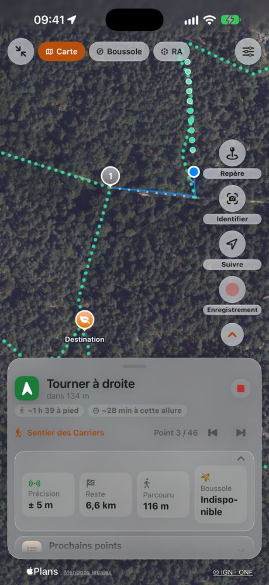
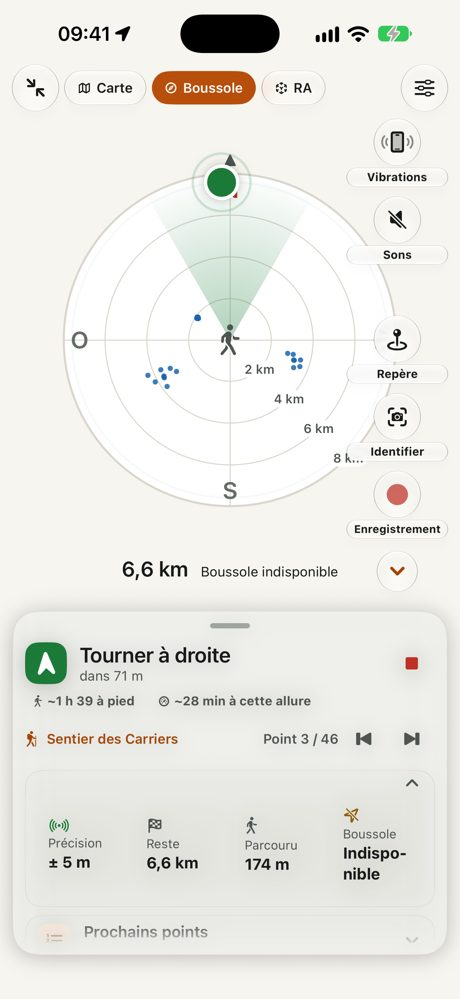
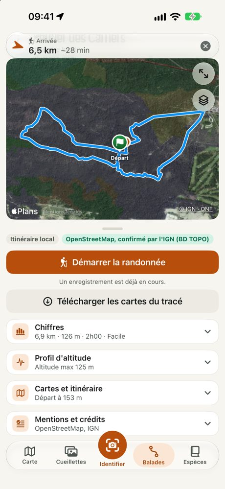



# SnapSpot: Cogumelos e Trilhos

Os seus cantinhos. As suas colheitas. Só seus.

**Explore as florestas, identifique os seus achados, volte aos seus melhores spots.** O companheiro de terreno do
apanhador de cogumelos, para iPhone. Mesmo sem rede.

<ul class="badges">
<li>Funciona sem rede</li>
<li>Sem conta</li>
<li>Sem publicidade</li>
<li>Os seus dados ficam no iPhone</li>
</ul>

## Explorar. Identificar. Memorizar. Reencontrar.

<figure><figcaption><b>1. Explorar</b> Carta florestal, florestas públicas, carta de solos, declives, relevo, cadastro: os mapas IGN ajudam a identificar os meios favoráveis. Um toque longo mostra o que cada camada indica aqui; descarregue-os antes de partir.</figcaption></figure>
<figure><figcaption><b>2. Identificar</b> Um modelo feito para cogumelos, no iPhone, sem rede. Várias propostas, as semelhanças perigosas assinaladas, nunca um veredicto.</figcaption></figure>
<figure><figcaption><b>3. Memorizar</b> Cada fotografia georreferenciada torna-se um spot. Organize por espécie, encontre por estação, por ano ou por comestibilidade, e coloque marcadores: carro, entrada da floresta, passagem.</figcaption></figure>
<figure><figcaption><b>4. Reencontrar</b> Mapa, bússola ou realidade aumentada até ao spot, com sons e vibrações quando o telemóvel fica no bolso. Os seus passeios ficam gravados.</figcaption></figure>

**O SnapSpot não é um mapa de zonas de colheita.** Não lhe diz para onde ir: ajuda-o a explorar e depois guarda a
memória dos seus próprios cantinhos. Os cogumelos voltam de ano para ano, no mesmo sítio e na mesma época: os spots
de ontem preparam a estação de amanhã.

## Identificar, com um modelo feito para cogumelos

A identificação assenta num **modelo especializado**, treinado com milhares de fotografias de cogumelos de França e
integrado na app. Baseia-se no BioCLIP, um modelo de reconhecimento de seres vivos do Imageomics Institute.

<video src="../images/identification-direct.mp4" poster="../images/identification-direct-poster.jpg" controls muted playsinline preload="none"></video>

*Em direto: a app analisa o que a câmara aponta, propõe espécies, assinala as semelhanças perigosas e depois cria o
spot.*

- **Mais de 200 espécies.** A app não as conhece todas: algumas espécies mortais não constam por falta de
  fotografias, e a app recorda-lho.
- **Nas nossas fotografias de teste**, a espécie certa surge em primeiro lugar em cerca de 9 casos em 10, e entre as
  três primeiras propostas em quase 98 % dos casos. A app mostra sempre várias propostas e os critérios a verificar,
  nunca um veredicto.
- **Em direto** com a câmara, ou sobre fotografias já tiradas.
- **Tudo no iPhone**: nenhuma imagem sai para a Internet, e funciona em plena floresta, sem rede.
- **Apple Intelligence** (iPhone compatíveis) fornece apenas uma descrição do que a fotografia mostra, comparada com
  os critérios da ficha. Nunca nomeia a espécie: as propostas são do modelo SnapSpot.
- **As espécies tóxicas ou mortais são sempre assinaladas.** Pode também ocultar do mapa as espécies não
  comestíveis.

<figure><figcaption>Em modo de avião, tudo funciona.</figcaption></figure>
<figure><figcaption>Uma ficha por espécie, consultável sem rede.</figcaption></figure>
<figure><figcaption>A estação de cada espécie.</figcaption></figure>

<figure><figcaption>Identificar: em direto, tirar uma fotografia, a partir das suas fotografias ou um spot sem fotografia.</figcaption></figure>
<figure><figcaption>Um achado: fotografia, espécie e comestibilidade, local e data, condições de crescimento, parecer do Apple Intelligence e «Guia-me».</figcaption></figure>
<figure><figcaption>O catálogo: 224 fichas, pesquisa, filtros, época e comestibilidade de cada espécie.</figcaption></figure>

> **Importante**: a identificação é indicativa e pode estar errada. Nunca consuma um cogumelo com base na app:
> mande-o verificar por um farmacêutico ou por uma associação micológica.

## Explorar e reencontrar os seus spots

As cartas do IGN descarregam-se com antecedência: fotografias aéreas, plano, relevo, carta florestal, florestas
públicas, florestas antigas, cadastro, declives, hidrografia, curvas de nível, geologia. Um toque longo no mapa diz o
que a camada mostra nesse local.

- **Carta de solos (INRAE)** junto das camadas florestais: o tipo de solo, com a sua legenda, lê-se com um toque longo.
- **Cada camada tem a sua própria transparência**, e um controlo global deixa ver a fotografia de satélite através delas.

<figure><figcaption>A ficha Camadas: opacidade global, mapa de fundo e camadas IGN por rubrica, cada uma com a sua transparência.</figcaption></figure>
<figure><figcaption>Um toque longo: o que as camadas mostram aqui (floresta, estatuto, solo, declive), a chuva de 7 dias, «Crescimento: pouco favorável» e «Ir».</figcaption></figure>
<figure><figcaption>Uma zona: as 3 fotografias tiradas no mesmo sítio, com «Ver as fotografias» e «Guia-me».</figcaption></figure>

<figure><figcaption>Condições de crescimento de um achado: índice 31 em 100, os 4 critérios (água, momento da chuva, humidade e temperatura do solo) e os bónus e penalizações do local.</figcaption></figure>
<figure><figcaption>Definições › Mapa e offline: mapa de fundo, opacidade das camadas e camadas por rubrica (floresta e vegetação, solo e água, relevo e declives).</figcaption></figure>
<figure><figcaption>A fase da lua (aqui o primeiro crescente) e as próximas luas, a título indicativo.</figcaption></figure>

## Memorizar os seus achados

Cada fotografia com localização torna-se um spot. Percorra-os em grelha ou em lista, filtre por período, espécie, ano ou comestibilidade, agrupe as fotografias do mesmo cogumelo, coloque marcadores (carro, ponto de água, cabana, árvore notável, miradouro) e junte fotografias da sua fototeca, de um álbum ou de outro iPhone. Cada fotografia guarda o seu local, a sua data, o tempo dos dias anteriores e um índice indicativo das condições de crescimento.

<figure><figcaption>A lista: fotografia, data, local, espécie e comestibilidade de cada achado.</figcaption></figure>
<figure><figcaption>Mais ações: juntar fotografias (câmara, fototeca, álbum, outro iPhone) e arrumar (duplicados, fotografias sem cogumelo).</figcaption></figure>
<figure><figcaption>Filtros do mapa: período, comestibilidade, espécie e «Enquadrar o mapa» nos seus achados.</figcaption></figure>

## Reencontrar um spot

A orientação leva-o a pé até um spot: distância, direção, tempo de marcha e, em realidade aumentada, um sonar no
chão que mostra a zona. Com o ecrã bloqueado, bipes e vibrações dizem-lhe se segue na direção certa, e uma voz pode
corrigir-lhe o rumo.

<video src="../images/guidage-ra.mp4" poster="../images/guidage-ra-poster.jpg" controls muted loop playsinline preload="none"></video>

*O sonar: uma onda parte do spot e alarga-se no chão, ao tamanho real da zona, para avaliar a distância.*

- **Três vistas**: mapa, bússola radar ou realidade aumentada, com uma gaveta que se puxa para ver o detalhe ou se minimiza para não perder o mapa de vista.
- **Vários pontos seguidos**: encadeie spots num percurso, ou coloque pontos no mapa e deixe o SnapSpot guiá-lo de um ao seguinte.

<figure><figcaption>A orientação em modo Bússola: radar dos achados à sua volta, direção e tempo a pé na gaveta.</figcaption></figure>
<figure><figcaption>Definições rápidas da orientação: sons, vibrações, copiloto de voz e orientação do ecrã.</figcaption></figure>
<figure><figcaption>O seu passeio no ecrã bloqueado.</figcaption></figure>

<figure><figcaption>A gaveta aberta em modo Mapa: próxima curva, precisão, distância restante e próximos pontos.</figcaption></figure>
<figure><figcaption>A coluna de botões aberta: vibrações, sons, marcador, identificar, gravação.</figcaption></figure>
<figure><figcaption>A orientação minimizada: um simples faixa no topo enquanto consulta a ficha do percurso.</figcaption></figure>

*Capturas de ecrã realizadas com dados de demonstração.*

## Caminhar e criar os seus percursos

- **Registo GPS** das suas caminhadas: distância, desnível, velocidade, pausas e marcadores, mesmo com o ecrã bloqueado.
- **Os seus próprios percursos**: encadeie os seus achados ou coloque pontos no mapa, e o SnapSpot guia-o de ponto em ponto.
- **Regresso ao início** em linha reta, pelo seu percurso ou pelos trilhos. Apenas «Pelos trilhos» contacta o serviço de itinerários do IGN, com a sua posição e o destino, nunca as suas fotografias nem os seus spots.
- **Gaveta de gravação**: tempo, distância, velocidade e marcadores de relance, pausa, paragem e «Regresso à partida» ao alcance do polegar.
- **Deteção do carro**: se se esquecer de parar a gravação no carro, o SnapSpot propõe cortar o fim do percurso.
- **Aviso do pôr do sol**: um alerta quando é hora de regressar, para que a noite não o surpreenda.

<figure><figcaption>Passeios: os seus percursos por data, com o balanço do período e o número de fotografias de cada um.</figcaption></figure>
<figure><figcaption>Um passeio: percurso colorido pela velocidade, miniaturas das fotografias tiradas, números e perfil.</figcaption></figure>
<figure><figcaption>A gravação em curso: tempo, distância, velocidade, desnível e «Regresso à partida».</figcaption></figure>

<figure><figcaption>Fim de um passeio: guardar, retomar a gravação ou eliminar.</figcaption></figure>
<figure><figcaption>Os meus itinerários: criar um itinerário, desenhá-lo com o dedo ou importar um ficheiro .snapspot.</figcaption></figure>
<figure><figcaption>Ações de um passeio: mudar o nome, anotar, recortar, fundir um GPX; regressar à partida, seguir por pontos, converter em itinerário.</figcaption></figure>

## Caminhadas

Um catálogo de quase 38 000 percursos em França (OpenStreetMap, IGN) está integrado na app e consulta-se offline: distância, desnível, perfil de altitude, duração e dificuldade, calculados pela app e dados a título indicativo.

- **Pesquisa por local e filtros** sobre os percursos de uma zona, num mapa e em lista.
- **Iniciar**: o SnapSpot grava a sua caminhada e guia-o ao longo do percurso, com indicações de voz nas curvas e um alerta se sair do trilho. A gravação pode ser desativada.
- **Os meus itinerários**: desenhe o seu à mão ou ponto a ponto, ajustado aos trilhos da rede do IGN (requer rede), e partilhe-o com outro iPhone ou exporte-o em GPX.

<figure><figcaption>O catálogo de caminhadas: mapa e lista com distância, desnível, dificuldade e fonte de cada percurso.</figcaption></figure>
<figure><figcaption>Ficha de um percurso: «Iniciar», escolher gravar ou não, mapas a descarregar, números e perfil de altitude.</figcaption></figure>
<figure><figcaption>Caminhada guiada: aviso «Vire à esquerda» e caminho a tracejado até ao próximo ponto.</figcaption></figure>

## Uma interface simples que se adapta a si

A interface do SnapSpot foi repensada para a forma como se usa o telemóvel na floresta: uma mão, pouco tempo, por vezes pouca rede.

- **Cinco separadores**: Mapa, Apanhas, Identificar (o botão grande ao centro), Passeios e Espécies.
- **Simples ou Especialista**: em Simples, os detalhes ficam recolhidos atrás de um pequeno botão; em Especialista, ficam abertos. Todas as funções e todos os dados continuam disponíveis em ambos, e os avisos de segurança nunca são recolhidos. Pode mudar a qualquer momento.
- **Claro ou escuro, vertical ou horizontal**: a interface segue o iPhone, e a orientação do ecrã pode ser forçada nas definições.
- **Ajuda integrada**: uma visita guiada, um centro de ajuda por temas com ilustrações e dicas que só aparecem uma vez.

<figure><figcaption>Simples ou Especialista: mesmas funções e dados, detalhes recolhidos ou abertos.</figcaption></figure>
<figure><figcaption>O centro de ajuda: visita guiada e temas (mapa, identificação, apanhas, passeios, orientação…).</figcaption></figure>
<figure><figcaption>O modo escuro no mapa: a mesma interface, cores adaptadas.</figcaption></figure>

<figure><figcaption>O mapa na horizontal: separadores em barra lateral à esquerda, botões à direita.</figcaption></figure>
<figure><figcaption>O separador Apanhas na horizontal, com os filtros em etiquetas.</figcaption></figure>

## Privacidade absoluta

- **Nenhum servidor SnapSpot, nenhuma conta, nenhuma publicidade, nenhum rastreio, nenhuma estatística de utilização.**
- As suas fotografias, spots, percursos e análises **ficam no seu iPhone**. Não os podemos ver, mesmo que
  quiséssemos.
- A identificação, a descrição e a orientação fazem-se **no dispositivo**.
- Apenas são contactados serviços públicos de mapas e de meteorologia (cartas do IGN, nomes de locais, pesquisa de um
  local, chuva dos últimos 14 dias), como em qualquer página web, sem nunca enviar as suas fotografias nem os seus
  spots. Os mapas descarregados com antecedência funcionam sem rede.
- Os seus cantinhos de cogumelos são seus: só saem do iPhone se os partilhar você mesmo.

## Também na app

- **Pistas de terreno**: anote o cheiro, a carne, o meio ou a esporada, por ditado ou por sugestões. Ponderam as
  propostas e um parecer comparativo da Apple Intelligence, que pode relançar.
- **Pesquisar no mapa**: um local, uma morada, coordenadas, ou um dos seus achados, um percurso, um marcador.
- **Chuva e lua**: a chuva dos últimos 14 dias e a humidade do solo na ficha «Aqui», e a fase da lua do dia, a título
  indicativo.
- **Condições de crescimento**: um índice indicativo baseado na chuva, na humidade e na temperatura do solo (requer rede), nunca uma promessa de colheita.
- **Partilha a partir de Fotografias**: a folha de partilha do iPhone envia fotografias para o SnapSpot, que lê a
  sua localização.
- **Exportação e transferência**: GPX, spots, percursos com as suas fotografias, ou toda a coleção para outro iPhone
  por AirDrop.
- **App Saúde**: os seus passeios podem ser aí registados como caminhadas (apenas escrita).
- **Fichas de espécies**: mais de 200, com estações, meios, fotografias de licença livre e créditos.
- **Nove línguas**: francês, inglês, alemão, espanhol, italiano, português, neerlandês, polaco e sueco.

[Política de privacidade](privacy) · [Assistência](support) · Contacto: snapspot.app@outlook.com
