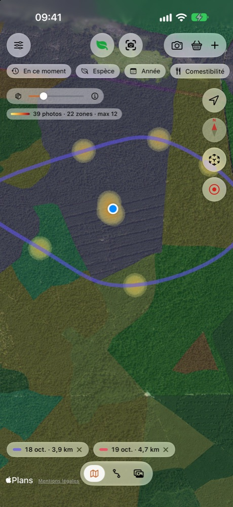
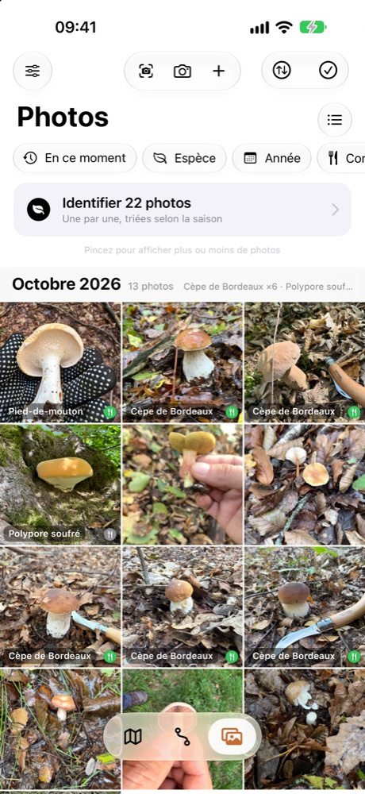
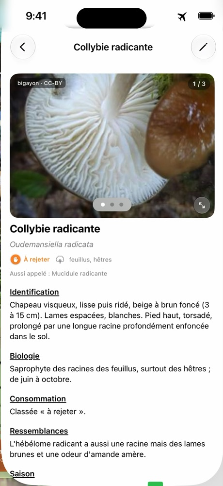
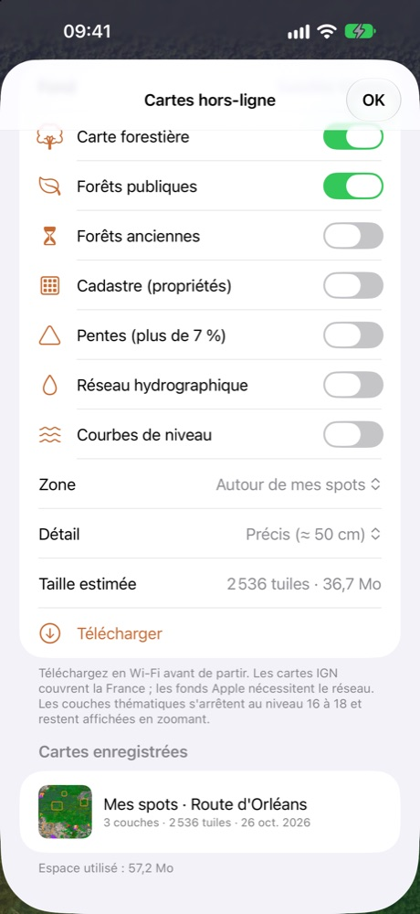
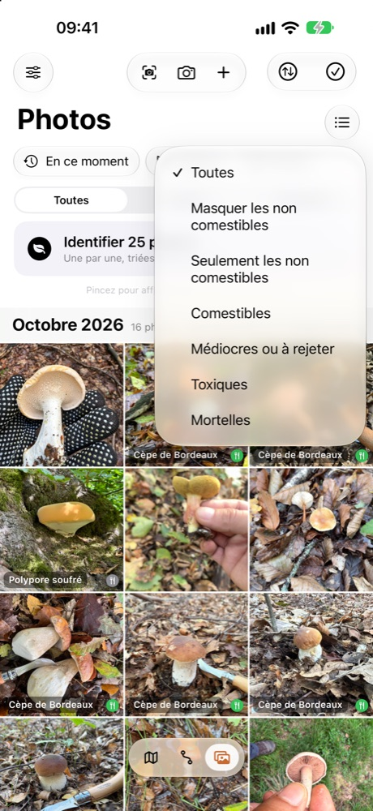
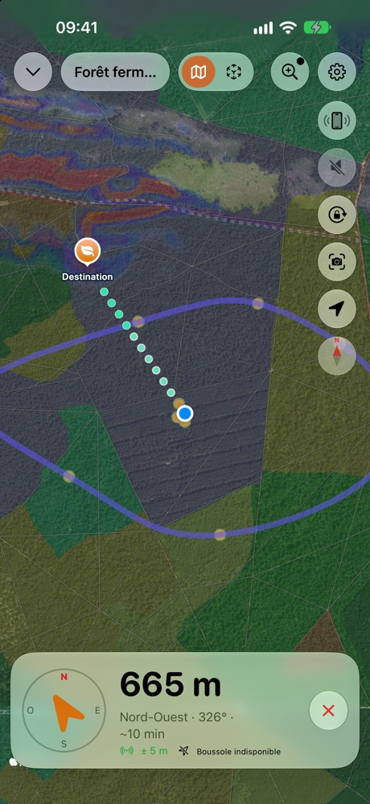
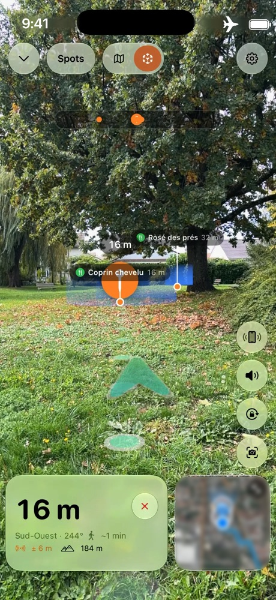
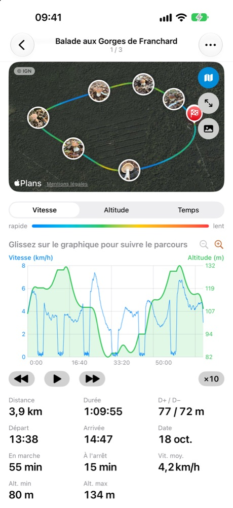



# SnapSpot

Os seus cantinhos. As suas colheitas. Só seus.

**Explore as florestas, identifique os seus achados, volte aos seus melhores spots.** O companheiro de terreno do
apanhador de cogumelos, para iPhone. Mesmo sem rede.

<ul class="badges">
<li>Funciona sem rede</li>
<li>Sem conta</li>
<li>Sem publicidade</li>
<li>Os seus dados ficam no iPhone</li>
</ul>

## Explorar. Identificar. Memorizar. Reencontrar.

<figure><figcaption><b>1. Explorar</b> Carta florestal, florestas públicas, florestas antigas, geologia, declives, relevo, cadastro: as cartas do IGN ajudam a localizar os habitats favoráveis e descarregam-se antes de partir.</figcaption></figure>
<figure><figcaption><b>2. Identificar</b> Um modelo feito para cogumelos, no iPhone, sem rede. Várias propostas, as semelhanças perigosas assinaladas, nunca um veredicto.</figcaption></figure>
<figure><figcaption><b>3. Memorizar</b> Cada fotografia georreferenciada torna-se um spot. Organize por espécie, encontre por estação, por ano ou por comestibilidade, e coloque marcadores: carro, entrada da floresta, passagem.</figcaption></figure>
<figure><figcaption><b>4. Reencontrar</b> Mapa, bússola ou realidade aumentada até ao spot, com sons e vibrações quando o telemóvel fica no bolso. Os seus passeios ficam gravados.</figcaption></figure>

**O SnapSpot não é um mapa de zonas de colheita.** Não lhe diz para onde ir: ajuda-o a explorar e depois guarda a
memória dos seus próprios cantinhos. Os cogumelos voltam de ano para ano, no mesmo sítio e na mesma época: os spots
de ontem preparam a estação de amanhã.

## Identificar, com um modelo feito para cogumelos

A identificação assenta num **modelo especializado**, treinado com milhares de fotografias de cogumelos de França e
integrado na app. Baseia-se no BioCLIP, um modelo de reconhecimento de seres vivos do Imageomics Institute.

<video src="../images/identification-direct.mp4" poster="../images/identification-direct-poster.jpg" controls muted playsinline preload="none"></video>

*Em direto: a app analisa o que a câmara aponta, propõe espécies, assinala as semelhanças perigosas e depois cria o
spot.*

- **Mais de 200 espécies.** A app não as conhece todas: algumas espécies mortais não constam por falta de
  fotografias, e a app recorda-lho.
- **Nas nossas fotografias de teste**, a espécie certa surge em primeiro lugar em cerca de 9 casos em 10, e entre as
  três primeiras propostas em quase 98 % dos casos. A app mostra sempre várias propostas e os critérios a verificar,
  nunca um veredicto.
- **Em direto** com a câmara, ou sobre fotografias já tiradas.
- **Tudo no iPhone**: nenhuma imagem sai para a Internet, e funciona em plena floresta, sem rede.
- **Apple Intelligence** (iPhone compatíveis) fornece apenas uma descrição do que a fotografia mostra, comparada com
  os critérios da ficha. Nunca nomeia a espécie: as propostas são do modelo SnapSpot.
- **As espécies tóxicas ou mortais são sempre assinaladas.** Pode também ocultar do mapa as espécies não
  comestíveis.

<figure><figcaption>Em modo de avião, tudo funciona.</figcaption></figure>
<figure><figcaption>Uma ficha por espécie, consultável sem rede.</figcaption></figure>
<figure><figcaption>A estação de cada espécie.</figcaption></figure>

> **Importante**: a identificação é indicativa e pode estar errada. Nunca consuma um cogumelo com base na app:
> mande-o verificar por um farmacêutico ou por uma associação micológica.

## Explorar e reencontrar os seus spots

As cartas do IGN descarregam-se com antecedência: fotografias aéreas, plano, relevo, carta florestal, florestas
públicas, florestas antigas, cadastro, declives, hidrografia, curvas de nível, geologia. Um toque longo no mapa diz o
que a camada mostra nesse local.

<figure><figcaption>Descarregue a zona antes de partir.</figcaption></figure>
<figure><figcaption>As suas fotografias, com a espécie e a comestibilidade.</figcaption></figure>
<figure><figcaption>Filtre por comestibilidade.</figcaption></figure>

A orientação leva-o a pé até um spot: distância, direção, tempo de marcha e, em realidade aumentada, um sonar no
chão que mostra a zona. Com o ecrã bloqueado, bipes e vibrações dizem-lhe se segue na direção certa, e uma voz pode
corrigir-lhe o rumo.

<video src="../images/guidage-ra.mp4" poster="../images/guidage-ra-poster.jpg" controls muted loop playsinline preload="none"></video>

*O sonar: uma onda parte do spot e alarga-se no chão, ao tamanho real da zona, para avaliar a distância.*

<figure><figcaption>Um toque longo no mapa, «Guiar-me»: um caminho de pontos até ao ponto escolhido.</figcaption></figure>
<figure><figcaption>Distância, direção e minimapa.</figcaption></figure>
<figure><figcaption>O seu passeio no ecrã bloqueado.</figcaption></figure>
<figure><figcaption>Um percurso, com as suas fotografias.</figcaption></figure>

*Capturas de ecrã realizadas com dados de demonstração.*

## Caminhar e criar os seus percursos

- **Registo GPS** das suas caminhadas: distância, desnível, velocidade, pausas e marcadores, mesmo com o ecrã bloqueado.
- **Os seus próprios percursos**: encadeie os seus achados ou coloque pontos no mapa, e o SnapSpot guia-o de ponto em ponto.
- **Regresso ao início** em linha reta, pelo seu percurso ou pelos trilhos. Apenas «Pelos trilhos» contacta o serviço de itinerários do IGN, com a sua posição e o destino, nunca as suas fotografias nem os seus spots.
- **Caminhadas**: um catálogo integrado de quase 38 000 percursos em França (OpenStreetMap, IGN), disponível offline, com distância, desnível, duração e dificuldade indicativos.

## Privacidade absoluta

- **Nenhum servidor SnapSpot, nenhuma conta, nenhuma publicidade, nenhum rastreio, nenhuma estatística de utilização.**
- As suas fotografias, spots, percursos e análises **ficam no seu iPhone**. Não os podemos ver, mesmo que
  quiséssemos.
- A identificação, a descrição e a orientação fazem-se **no dispositivo**.
- Apenas são contactados serviços públicos de mapas e de meteorologia (cartas do IGN, nomes de locais, pesquisa de um
  local, chuva dos últimos 14 dias), como em qualquer página web, sem nunca enviar as suas fotografias nem os seus
  spots. Os mapas descarregados com antecedência funcionam sem rede.
- Os seus cantinhos de cogumelos são seus: só saem do iPhone se os partilhar você mesmo.

## Também na app

- **Pistas de terreno**: anote o cheiro, a carne, o meio ou a esporada, por ditado ou por sugestões. Ponderam as
  propostas e um parecer comparativo da Apple Intelligence, que pode relançar.
- **Pesquisar no mapa**: um local, uma morada, coordenadas, ou um dos seus achados, um percurso, um marcador.
- **Chuva e lua**: a chuva dos últimos 14 dias e a humidade do solo na ficha «Aqui», e a fase da lua do dia, a título
  indicativo.
- **Condições de crescimento**: um índice indicativo baseado na chuva, na humidade e na temperatura do solo (requer rede), nunca uma promessa de colheita.
- **Partilha a partir de Fotografias**: a folha de partilha do iPhone envia fotografias para o SnapSpot, que lê a
  sua localização.
- **Exportação e transferência**: GPX, spots, percursos com as suas fotografias, ou toda a coleção para outro iPhone
  por AirDrop.
- **App Saúde**: os seus passeios podem ser aí registados como caminhadas (apenas escrita).
- **Fichas de espécies**: mais de 200, com estações, meios, fotografias de licença livre e créditos.
- **Nove línguas**: francês, inglês, alemão, espanhol, italiano, português, neerlandês, polaco e sueco.

[Política de privacidade](privacy) · [Assistência](support) · Contacto: snapspot.app@outlook.com
